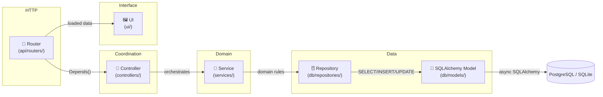
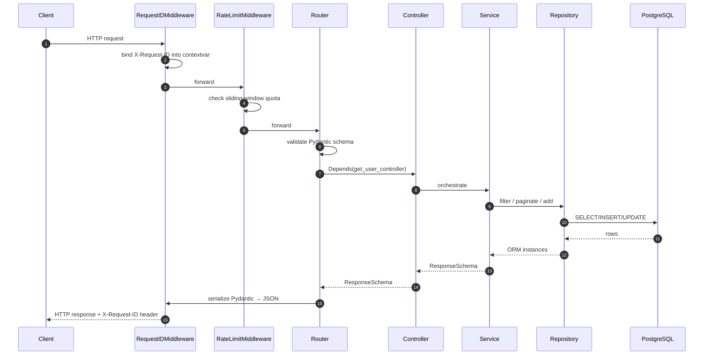

# Architecture

The SDK enforces a strict **router → controller → service → repository** layering. Every Tempest project follows the same shape, so a developer dropped into a new repo finds the file they need on the first try.

## The four layers



## What lives where

!!! abstract "Layer responsibilities"

    | Layer | Owns | NEVER touches |
    | --- | --- | --- |
    | **Router** | HTTP verbs, status codes, request/response schemas, `Depends()` | DB, business logic |
    | **Controller** | Coordination across multiple services, cross-cutting policy (audit log, outbox emit, downstream notify) | DB, request/response shape |
    | **Service** | Domain rules (uniqueness, derived state, transactional flow) | HTTP, SQLAlchemy types |
    | **Repository** | Raw async SQLAlchemy queries, CRUD + filter + pagination | Domain rules, HTTP |
    | **UI** (when the service serves HTML) | Pages, components, forms and the stylesheet — *what it looks like* | DB, controllers, services, HTTP |

The repository **MUST** be a [`BaseRepository[ModelType]`][tempest_fastapi_sdk.BaseRepository] subclass (or instance). The service **MUST** be a [`BaseService[RepositoryT, ResponseT]`][tempest_fastapi_sdk.BaseService] subclass. The controller **MUST** be a [`BaseController[ServiceT, ResponseT]`][tempest_fastapi_sdk.BaseController] subclass — even when every method is a pass-through, because the controller is the seam to add cross-service coordination later — or, when it orchestrates several services with no single-resource CRUD, a [`Controller`][tempest_fastapi_sdk.Controller] subclass (see [A controller that orchestrates](#a-controller-that-orchestrates-controller)).

## Mandatory project layout

```text
<service>/
├── main.py                          # ONE-LINER: from src.server import run; run()
└── src/ (or app/)
    ├── __init__.py                  # re-exports run from src.server
    ├── server.py                    # programmatic uvicorn.run() + module-level FastAPI app
    ├── api/
    │   ├── app.py                   # create_app() factory — middleware + handlers + wiring (thin)
    │   ├── routers/                 # HTTP endpoints, no business logic
    │   ├── dependencies/            # PACKAGE (auth.py + resources.py + controllers.py / services.py)
    │   └── docs/                    # OpenAPI customization
    ├── controllers/                 # Orchestrate between services
    ├── services/                    # Business logic layer
    ├── schemas/                     # Pydantic v2 request/response DTOs
    ├── core/                        # settings.py + constants + exceptions + logging
    ├── db/ (optional)
    │   ├── configs/names.py         # table names, single source
    │   ├── models/                  # SQLAlchemy ORM models
    │   └── repositories/            # Data access layer
    ├── ui/ (optional)               # interface layer — only with the [ssr] extra
    │   ├── pages/                   # one class per screen
    │   ├── layout/                  # the chrome every page inherits
    │   ├── components/              # reusable pieces
    │   └── styles.py                # the service's typed stylesheet
    ├── utils/ (optional)            # Shared stateless helpers
    ├── queue/ (optional)            # FastStream consumers/publishers
    └── tasks/ (optional)            # TaskIQ background tasks
```

!!! tip "`db/configs/names.py` rules out a class of error"
    Holding each table name in a constant makes `__tablename__` and the
    `ForeignKey` string come from the same symbol — renaming becomes one
    line instead of a hunt for scattered strings. Missing one side does
    not fail on the spot: SQLAlchemy resolves the FK target only when it
    configures the mappers, so the error arrives at application startup,
    or inside a migration pointing at a table that no longer exists.

    As of **v0.291.0** `tempest new` writes the file with the user
    table's name already in it, and the project's `CLAUDE.md` teaches the
    recipe from there. See
    [Database › Centralizing table names](recipes/database.md#centralizing-table-names).

!!! warning "Rules that are not negotiable"

    - `main.py` at the service root is a **one-liner** that imports `run` from `src.server`. Never `subprocess.run(["uvicorn", ...])`.
    - `src/server.py` exposes both a `run()` function and the importable `app` instance.
    - `api/dependencies/` is **always a package**, never a flat file. Auth lives in `auth.py`; factory providers live in `controllers.py` (or `services.py` when there is no controller layer yet).
    - **Infra singletons (db / storage / mail) live in `dependencies/resources.py`**, built once (`db = AsyncDatabaseManager(**settings.database_kwargs())`) and reached through `get_db` / `get_session` / `get_storage` / `get_mailer` providers. `app.py` **imports** those resources for the lifespan and router wiring — it never builds them inline. This keeps `app.py` thin and gives a single owner of resource lifecycle.
    - Routers receive controllers (and sessions/resources) via `Depends`, never constructed inline.
    - Meta endpoints (`/health`, `/tool-spec`) live at the **root prefix**; business endpoints live under `/api/<domain>`.

## The interface layer (`ui/`)

When the service serves HTML — not only JSON — it gains a fifth layer,
**beside** `controllers` and `services`. It exists only with the `[ssr]`
extra; without it, do not create the empty package.

| Layer | May import | Never imports |
| --- | --- | --- |
| `api/routers` | `controllers`, `ui`, `schemas` | `db` |
| `ui` | `schemas`, other parts of `ui` | `controllers`, `services`, `db` |
| `controllers` | `services`, `schemas` | `ui` |
| `services` | `db/repositories`, `schemas` | `ui` |

!!! warning "A page receives loaded data"
    A page fetches **nothing**: the router loads through a controller and
    passes the materialised result. An `await` inside `body()` means a
    responsibility slipped a layer.

`tempest new <service> --extras "ssr"` writes the whole layer, working
(and `tempest generate --src` adds it to a project that already exists).
Details in [UI layer](recipes/ui.md),
[Forms from Pydantic schemas](recipes/ui-forms.md) and
[Typed CSS](recipes/ui-css.md).

!!! tip "And when the frontend is an app, not a page"
    The `ui` layer renders HTML **on the server**. When the screen needs
    client-side state — a SPA — the path is still Python:
    **[tempestweb](recipes/tempestweb-frontend.md)** writes the interface
    and compiles it to WASM (or runs it in server-mode), and the SDK serves
    the build through `make_web_app_router` / `build_web_app`, on the same
    origin as the API. The two live together:
    [Fullstack web](fullstack-web.md) compares when to use which.

## Request lifecycle



Every step has a clear owner — the **router never talks to SQLAlchemy**, the **repository never raises HTTP exceptions** (it raises the `not_found_exception` configured on `__init__`, and the exception handler turns it into the JSON envelope).

## Exception envelope

The SDK ships [`AppException`][tempest_fastapi_sdk.AppException] + [`register_exception_handlers`][tempest_fastapi_sdk.register_exception_handlers] so every error in your service serializes to the same JSON shape:

```json
{
    "detail": "Usuário não encontrado",
    "code": "USER_NOT_FOUND",
    "details": {"user_id": "01923..."}
}
```

The frontend branches on `code` (stable, machine-readable), never on the (potentially translated) `detail`.

### The 500 goes through CORS too

An exception no handler catches becomes a `500` with `code: "INTERNAL_SERVER_ERROR"`. Starlette runs the `Exception` handler inside `ServerErrorMiddleware`, the **outermost** layer of the stack, so on its own that envelope would leave without passing through `CORSMiddleware`: with no `Access-Control-Allow-Origin` the browser discards the response and `fetch` rejects with `TypeError: Failed to fetch` — no status, no `code`, no `X-Request-ID`.

That is why `register_exception_handlers` also installs [`ErrorEnvelopeMiddleware`][tempest_fastapi_sdk.ErrorEnvelopeMiddleware] as the **innermost** middleware. From there the 500 passes through every middleware you added, and the order of the calls stops mattering:

```python
from fastapi import FastAPI
from fastapi.testclient import TestClient

from tempest_fastapi_sdk import (
    RequestIDMiddleware,
    apply_cors,
    register_exception_handlers,
)

app: FastAPI = FastAPI()
app.add_middleware(RequestIDMiddleware)
apply_cors(app, origins=["https://front.example"])
register_exception_handlers(app)


@app.get("/boom")
async def boom() -> None:
    raise RuntimeError("unhandled failure")


client: TestClient = TestClient(app, raise_server_exceptions=False)
response = client.get("/boom", headers={"Origin": "https://front.example"})
print(response.status_code, response.headers["access-control-allow-origin"])
print(response.json()["details"]["request_id"] == response.headers["x-request-id"])
```

```text
500 https://front.example
True
```

!!! note "What stays the same"
    - The layer **does not decide CORS**. An origin outside the allow-list still gets no header, on the 500 too.
    - After sending the envelope the exception is **re-raised**, as Starlette already did: the ASGI server still logs it, and a `TestClient` with the default `raise_server_exceptions=True` still raises it in your test.
    - A failure after the response started (a stream that breaks mid-body) is re-raised with no second response, because the status is already on the wire. It is logged and reaches `on_server_error` once, like a plain 500.
    - `register_exception_handlers` must run **before** the application starts; after that the stack is built and it raises `RuntimeError`.

## Where to go next

| You want to… | Read |
| --- | --- |
| Build a feature step by step | **[Tutorial »](tutorial.md)** |
| Wire a specific helper | **[Recipes »](recipes/index.md)** |
| Look up a class signature | **[Reference »](reference.md)** |
| Upgrade from an older version | **[Migration guide »](migration.md)** |

## Controllers & services layering


`BaseService[RepositoryT, ResponseT]` and `BaseController[ServiceT, ResponseT]` are generic skeletons matching the SDK layering (router → controller → service → repository). They expose pass-through CRUD methods so simple endpoints can subclass them without overriding anything; you override only methods that need orchestration.

What you inherit by subclassing `BaseService[RepositoryT, ResponseT]`:

| Method | Returns | Notes |
| --- | --- | --- |
| `get_by_id(id)` | `ResponseT` | Awaits `repository.get_by_id` + `repository.map_to_response`. Raises `repository.not_found_exception` on miss. |
| `get_or_none(filters)` | ``ResponseT | None`` | Same shape, returns `None` instead of raising. |
| `list(filters=None, order_by=None, ascending=True)` | `list[ResponseT]` | Returns `[]` on empty match (never raises). |
| `paginate(filters=None, order_by=None, page=1, page_size=20, ascending=True)` | `dict` with mapped `items` + `total`/`page`/`page_size`/`pages`. | Offset pagination via `repository.paginate`. |
| `count(filters=None)` | `int` | Pass-through to `repository.count`. |
| `exists(filters)` | `bool` | Pass-through to `repository.exists`. |
| `update(id, data)` | `ResponseT` | Fetch by id, copy the fields present in `data` (typed by `UpdateT`, the optional 3rd generic param — defaults to `BaseSchema`) onto the row, persist, map. `to_dict()` drops unset/`None`, so it serves PUT and PATCH. |
| `delete(id)` | `None` | Hard delete via `repository.delete`. |

`map_to_response` is `await`-ed when it returns a coroutine, so async mappers work transparently — no method override needed.

What you inherit by subclassing `BaseController[ServiceT, ResponseT]`:

| Method | Forwards to | Notes |
| --- | --- | --- |
| `get_by_id(id)` | `service.get_by_id` | Same return type as the service. |
| `list(filters, order_by, ascending)` | `service.list` | Same. |
| `paginate(filters, order_by, page, page_size, ascending)` | `service.paginate` | Same. |
| `count(filters)` | `service.count` | Same. |
| `update(id, data)` | `service.update` | Same. |
| `delete(id)` | `service.delete` | Same. |

!!! tip "Typing the `update` payload end to end"
    The 3rd generic parameter is the update schema, and it must be the **same** on both layers: a service declared as `BaseService[Repo, Resp, MyUpdateSchema]` fits `BaseController[MyService, Resp, MyUpdateSchema]`. Omit the 3rd parameter on either one and it falls back to the `BaseSchema` default, leaving `update`'s `data` loosely typed.

    ```python
    from tempest_fastapi_sdk import BaseController, BaseService

    from src.db.repositories import CoinPackRepository
    from src.schemas import CoinPackResponseSchema, CoinPackUpdateSchema


    class CoinPackService(
        BaseService[CoinPackRepository, CoinPackResponseSchema, CoinPackUpdateSchema]
    ):
        """Service typed over the concrete update schema."""


    class CoinPackController(
        BaseController[CoinPackService, CoinPackResponseSchema, CoinPackUpdateSchema]
    ):
        """Controller repeating the same update schema."""
    ```

    !!! warning "Requires 0.167.1+"
        On earlier versions this pair failed type checking with `Type parameter "UpdateT@BaseService" is invariant, but "CoinPackUpdateSchema" is not the same as "BaseSchema"` — `ServiceT`'s bound pinned that invariant parameter to `BaseSchema`. Fixed in 0.167.1; nothing changes at runtime.

When a use case needs domain rules, override the inherited method in the service. When a use case needs to coordinate more than one service, override the inherited method (or add a new one) in the controller. The router never grows — it only depends on the controller.

```python
# src/services/user_service.py
from uuid import UUID

from tempest_fastapi_sdk import BaseService

from src.db.repositories import UserRepository
from src.schemas.user import UserCreate, UserResponse, UserUpdate
from src.utils.security import password_utils


class UserService(BaseService[UserRepository, UserResponse]):
    """Business logic for the user feature."""

    async def signup(self, data: UserCreate) -> UserResponse:
        # Business logic — hash the password, then delegate to the repo.
        instance = self.repository.map_to_model(
            {
                "name": data.name,
                "email": data.email,
                "password_hash": password_utils.hash(data.password),
            },
        )
        created = await self.repository.add(instance)
        return self.repository.map_to_response(created)


# src/controllers/user_controller.py
from tempest_fastapi_sdk import BaseController

from src.schemas.user import UserCreate, UserResponse
from src.services.user_service import UserService


class UserController(BaseController[UserService, UserResponse]):
    """Thin orchestration over UserService."""

    async def signup(self, data: UserCreate) -> UserResponse:
        # Pass-through today; the controller is the seam to add
        # cross-service coordination later (audit log, outbox event,
        # downstream notification, etc.) without touching the router.
        return await self.service.signup(data)


# src/api/dependencies/controllers.py
from fastapi import Depends
from sqlalchemy.ext.asyncio import AsyncSession

from src.api.dependencies.resources import db
from src.controllers.user_controller import UserController
from src.db.repositories import UserRepository
from src.services.user_service import UserService


def get_user_controller(
    session: AsyncSession = Depends(db.session_dependency),
) -> UserController:
    # UserRepository is a subclass of BaseRepository[UserModel] whose
    # __init__ injects `model=UserModel` via super().__init__(session, model=UserModel).
    # See the tutorial for the full skeleton:
    # https://mauriciobenjamin700.github.io/tempest-fastapi-sdk/en/tutorial/#6-repository
    return UserController(UserService(UserRepository(session)))


# src/api/routers/users.py
from fastapi import APIRouter, Depends, status

from src.api.dependencies.controllers import get_user_controller
from src.controllers.user_controller import UserController
from src.schemas.user import UserCreate, UserResponse

router = APIRouter(prefix="/users", tags=["users"])


@router.post(
    "/",
    response_model=UserResponse,
    status_code=status.HTTP_201_CREATED,
)
async def create_user(
    data: UserCreate,
    controller: UserController = Depends(get_user_controller),
) -> UserResponse:
    return await controller.signup(data)
```

Keep controllers present even when they only pass through — the import graph stays uniform across services, so adding cross-cutting policy later doesn't change the router signature.

### A controller that orchestrates — `Controller`

`BaseController` takes **one** service and passes its CRUD through. A
controller that coordinates several services — issue the invoice, post to the
ledger, notify — has no `get_by_id` or `delete` of a single resource;
inheriting `BaseController` there would hand the router methods that mean
nothing. For that case there is [`Controller`][tempest_fastapi_sdk.Controller],
the root of the layer: no methods at all, only the convention — services
**injected** through `__init__`, no database access (no session, no
repository). `BaseController` is its CRUD specialization, so
`isinstance(controller, Controller)` holds for both.

| Your controller… | Inherit |
| --- | --- |
| passes one resource's CRUD through, via one service | `BaseController[ServiceT, ResponseT, UpdateT]` |
| coordinates several services, with no single-resource CRUD | `Controller` |

```python
# src/controllers/billing_controller.py
from uuid import UUID

from tempest_fastapi_sdk import Controller

from src.schemas import ChargeResponse
from src.services import InvoiceService, LedgerService, NotificationService


class BillingController(Controller):
    """Charge = invoice + ledger posting + notification."""

    def __init__(
        self,
        invoices: InvoiceService,
        ledger: LedgerService,
        notifications: NotificationService,
    ) -> None:
        self.invoices: InvoiceService = invoices
        self.ledger: LedgerService = ledger
        self.notifications: NotificationService = notifications

    async def charge(self, customer_id: UUID, amount_cents: int) -> ChargeResponse:
        invoice = await self.invoices.issue(customer_id, amount_cents)
        await self.ledger.post(invoice.id, amount_cents)
        await self.notifications.invoice_issued(customer_id, invoice.id)
        return ChargeResponse(invoice_id=invoice.id, amount_cents=amount_cents)


# src/api/dependencies/controllers.py
from fastapi import Depends
from sqlalchemy.ext.asyncio import AsyncSession

from src.api.dependencies.resources import db
from src.controllers.billing_controller import BillingController
from src.db.repositories import InvoiceRepository, LedgerRepository
from src.services import InvoiceService, LedgerService, NotificationService


def get_billing_controller(
    session: AsyncSession = Depends(db.session_dependency),
) -> BillingController:
    return BillingController(
        InvoiceService(InvoiceRepository(session)),
        LedgerService(LedgerRepository(session)),
        NotificationService(),
    )
```

The provider builds the services, the controller only receives them — the
session lives in the provider and the repositories, never in the controller.

!!! note "The convention is not checked at runtime"
    `__init__` belongs to the subclass, and telling a service from a
    repository by annotation would need its forward references resolved.
    Review is what enforces the rule.

## Service, repository and controller patterns

The sections above say **what** each layer inherits. This one answers the
questions the first real service raises: where the mapper lives, what to do
when a service needs **two** repositories, how the `session`, the settings
and the mailer reach the controller, where the permission check runs, and
what the router returns.

All of it in one complete example — copy it into a file and run
`uv run python app.py`. In a project each class lives in its own layer
(`db/models/`, `schemas/`, `core/exceptions.py`, `db/repositories/`,
`services/`, `controllers/`, `api/dependencies/controllers.py`,
`api/routers/`); here they sit together so the example runs on its own.

```python
from collections.abc import AsyncIterator
from contextlib import asynccontextmanager
from uuid import UUID

from fastapi import APIRouter, Depends, FastAPI, status
from fastapi.testclient import TestClient
from pydantic import Field
from sqlalchemy import ForeignKey, String
from sqlalchemy.ext.asyncio import AsyncSession
from sqlalchemy.orm import Mapped, mapped_column

from tempest_fastapi_sdk import (
    AsyncDatabaseManager,
    BaseAppSettings,
    BaseController,
    BaseModel,
    BaseRepository,
    BaseResponseSchema,
    BaseSchema,
    BaseService,
    NotFoundException,
    ValidationException,
    register_exception_handlers,
)


class Settings(BaseAppSettings):
    """Service configuration."""

    MAX_PRICE_CENTS: int = 100_000


class CategoryModel(BaseModel):
    """A catalogue category."""

    name: Mapped[str] = mapped_column(String(64))


class ProductModel(BaseModel):
    """A product, always inside a category."""

    name: Mapped[str] = mapped_column(String(64))
    price_cents: Mapped[int]
    category_id: Mapped[UUID] = mapped_column(ForeignKey("category.id"))


class ProductCreateSchema(BaseSchema):
    """Product creation payload."""

    name: str = Field(min_length=1, max_length=64)
    price_cents: int = Field(gt=0)
    category_id: UUID


class ProductResponseSchema(BaseResponseSchema):
    """A product as the API returns it."""

    name: str
    price_cents: int
    category_id: UUID


class CategoryNotFoundError(NotFoundException):
    """The given category does not exist."""

    code: str = "CATEGORY_NOT_FOUND"


class ProductNotFoundError(NotFoundException):
    """The given product does not exist."""

    code: str = "PRODUCT_NOT_FOUND"


class ProductPriceAboveLimitError(ValidationException):
    """The price is above the configured ceiling."""

    code: str = "PRODUCT_PRICE_ABOVE_LIMIT"


class CategoryRepository(BaseRepository[CategoryModel]):
    """Data access for categories."""

    def __init__(self, session: AsyncSession) -> None:
        """Bind the repository to the session.

        Args:
            session (AsyncSession): The request-scoped session.
        """
        super().__init__(
            session,
            model=CategoryModel,
            not_found_exception=CategoryNotFoundError,
        )


class ProductRepository(BaseRepository[ProductModel]):
    """Data access for products; owns the response mapper."""

    def __init__(self, session: AsyncSession) -> None:
        """Bind the repository to the session.

        Args:
            session (AsyncSession): The request-scoped session.
        """
        super().__init__(
            session,
            model=ProductModel,
            not_found_exception=ProductNotFoundError,
        )

    def map_to_response(self, instance: ProductModel) -> ProductResponseSchema:
        """Map a row to the response schema.

        Args:
            instance (ProductModel): The ORM row.

        Returns:
            ProductResponseSchema: The product, ready for the API.
        """
        return ProductResponseSchema.model_validate(instance)


class ProductService(BaseService[ProductRepository, ProductResponseSchema]):
    """Business rules for products."""

    def __init__(
        self,
        repository: ProductRepository,
        *,
        categories: CategoryRepository,
        max_price_cents: int,
    ) -> None:
        """Take the main repository plus what the creation rule reads.

        Args:
            repository (ProductRepository): The resource's own repository.
            categories (CategoryRepository): Read to validate the category.
            max_price_cents (int): Price ceiling, taken from the settings.
        """
        super().__init__(repository)
        self.categories: CategoryRepository = categories
        self.max_price_cents: int = max_price_cents

    async def create(self, data: ProductCreateSchema) -> ProductResponseSchema:
        """Create a product in an existing category, under the price ceiling.

        Args:
            data (ProductCreateSchema): The creation payload.

        Returns:
            ProductResponseSchema: The created product.

        Raises:
            CategoryNotFoundError: When the category does not exist.
            ProductPriceAboveLimitError: When the price is above the ceiling.
        """
        await self.categories.get_by_id(data.category_id)
        if data.price_cents > self.max_price_cents:
            raise ProductPriceAboveLimitError(
                details={"max_price_cents": self.max_price_cents},
            )
        instance = self.repository.map_to_model(data.to_dict())
        instance = await self.repository.add(instance)
        return self.repository.map_to_response(instance)


class ProductController(BaseController[ProductService, ProductResponseSchema]):
    """Product use cases; a pass-through for now."""

    async def create(self, data: ProductCreateSchema) -> ProductResponseSchema:
        """Create a product.

        Args:
            data (ProductCreateSchema): The creation payload.

        Returns:
            ProductResponseSchema: The created product.
        """
        return await self.service.create(data)


settings: Settings = Settings()
db: AsyncDatabaseManager = AsyncDatabaseManager("sqlite+aiosqlite:///:memory:")


def get_settings() -> Settings:
    """Return the process settings.

    Returns:
        Settings: The single instance, replaceable through ``dependency_overrides``.
    """
    return settings


def get_product_controller(
    session: AsyncSession = Depends(db.session_dependency),
    app_settings: Settings = Depends(get_settings),
) -> ProductController:
    """Build repository, service and controller for one request.

    Args:
        session (AsyncSession): The request-scoped session.
        app_settings (Settings): The process settings.

    Returns:
        ProductController: The controller bound to that session.
    """
    service = ProductService(
        ProductRepository(session),
        categories=CategoryRepository(session),
        max_price_cents=app_settings.MAX_PRICE_CENTS,
    )
    return ProductController(service)


router: APIRouter = APIRouter(prefix="/api/products", tags=["products"])


@router.post("", status_code=status.HTTP_201_CREATED)
async def create_product(
    data: ProductCreateSchema,
    controller: ProductController = Depends(get_product_controller),
) -> ProductResponseSchema:
    """Create a product.

    Args:
        data (ProductCreateSchema): The creation payload.
        controller (ProductController): Injected by the provider.

    Returns:
        ProductResponseSchema: The created product.
    """
    return await controller.create(data)


@router.get("/{product_id}")
async def get_product(
    product_id: UUID,
    controller: ProductController = Depends(get_product_controller),
) -> ProductResponseSchema:
    """Fetch a product by id.

    Args:
        product_id (UUID): The product id.
        controller (ProductController): Injected by the provider.

    Returns:
        ProductResponseSchema: The product.
    """
    return await controller.get_by_id(product_id)


@asynccontextmanager
async def lifespan(app: FastAPI) -> AsyncIterator[None]:
    """Create the tables and one sample category.

    Args:
        app (FastAPI): The application.

    Yields:
        None: While the application runs.
    """
    await db.create_tables()
    async with db.get_session_context() as session:
        session.add(CategoryModel(id=UUID(int=1), name="Books"))
        await session.commit()
    yield
    await db.disconnect()


app: FastAPI = FastAPI(lifespan=lifespan)
register_exception_handlers(app)
app.include_router(router)


with TestClient(app) as client:
    created = client.post(
        "/api/products",
        json={"name": "Dune", "price_cents": 5990, "category_id": str(UUID(int=1))},
    )
    print(created.status_code, created.json()["name"])
    fetched = client.get(f"/api/products/{created.json()['id']}")
    print(fetched.status_code, fetched.json()["price_cents"])
    missing = client.post(
        "/api/products",
        json={"name": "Dune", "price_cents": 5990, "category_id": str(UUID(int=2))},
    )
    print(missing.status_code, missing.json()["code"])
    too_high = client.post(
        "/api/products",
        json={"name": "Rare", "price_cents": 500_000, "category_id": str(UUID(int=1))},
    )
    print(too_high.status_code, too_high.json()["code"], too_high.json()["details"])
    app.dependency_overrides[get_settings] = lambda: Settings(MAX_PRICE_CENTS=1_000)
    capped = client.post(
        "/api/products",
        json={"name": "Dune", "price_cents": 5990, "category_id": str(UUID(int=1))},
    )
    print(capped.status_code, capped.json()["details"])
```

```text
201 Dune
200 5990
404 CATEGORY_NOT_FOUND
422 PRODUCT_PRICE_ABOVE_LIMIT {'max_price_cents': 100000}
422 {'max_price_cents': 1000}
```

Let's take it piece by piece.

### The mapper lives in the repository

`ProductRepository.map_to_response` is the resource's **only** translation
from ORM row to response schema. `BaseService` calls it on every path that
returns mapped data — `get_by_id`, `get_or_none`, `list`, `paginate` and
`update` — so the example's `get_product` works without a line of service
code: the inherited `get_by_id` loads the row and runs it through the mapper.

The contract, as the code stands today:

| `BaseRepository` method | Base default | Who calls it |
| --- | --- | --- |
| `map_to_response(instance)` | raises `NotImplementedError("Subclasses must implement map_to_response")` | `BaseService.get_by_id` / `get_or_none` / `list` / `paginate` / `update` |
| `map_to_model(data)` | `self.model(**data)` | your service, when creating (`self.repository.map_to_model(data.to_dict())`) |
| `map_to_schema(instance)` | raises `NotImplementedError` | nothing in the SDK; it exists for your code |

It is not abstract in the `abc` sense: a repository without the mapper
instantiates fine, and `count`, `exists` and `delete` work. The failure shows
up on the first call that maps — over HTTP, a `500`. So every repository
handed to a `BaseService` implements `map_to_response`; the example's
`CategoryRepository` does not, because no `BaseService` receives it — the
`ProductService` only calls `get_by_id` on it, which returns the row
unmapped.

!!! tip "`async` mapper"
    When mapping needs an `await` (loading a relationship, say), declare
    `async def map_to_response`. `BaseService` awaits the result when it is
    awaitable — nothing to override in the service.

Why the repository and not a service helper: the mapper sits next to the
query that loaded the row, and `BaseService` can only hand you the inherited
CRUD because it knows where to find it. A service that rewrites `list` as
`[self.repository.map_to_response(x) for x in ...]` is reimplementing the
base.

### One repository per service — and when there are several

`BaseService[RepositoryT, ResponseT, UpdateT]` takes **one** repository in
`__init__`: the one for the resource whose CRUD it inherits. The third
generic parameter is optional (see [the tip above](#controllers-services-layering)).
When a use case needs more data, the question is *whose rule it is*:

| Situation | Where the second repository goes |
| --- | --- |
| The rule belongs to this resource and only **reads** or **writes alongside** other data — checking the category exists, writing an order and its items | a keyword-only parameter of the service's `__init__`, after `super().__init__(repository)` — like `categories` in the example |
| The other data has rules of its own and already has a service | the **controller** receives both services and orchestrates (see [`Controller`](#a-controller-that-orchestrates-controller)) |
| The service has no repository at all (a static catalogue, a facade over an external API) | no `BaseService`; mark the class with `# tempest: no-base-service` |

`ProductService.__init__` adds dependencies, so it is not the redundant
`__init__` that `SVC003` flags — that rule only flags one that stores the
repository and nothing else.

!!! warning "Two writes, one transaction"
    Every `BaseRepository` write method `COMMIT`s on its own. When the rule
    writes through two repositories, wrap both writes in `async with
    self.repository.transaction():`. The block covers every repository on
    the **same** `AsyncSession` — and the provider is what guarantees that,
    by building both on the request's session. Details in
    [Transactions](recipes/transactions.md).

### Controllers arrive through `Depends` providers

`get_product_controller` is the only place that knows how to build the
graph: it opens the request's session, reads the settings, builds both
repositories, the service and the controller. The router only declares
`controller: ProductController = Depends(get_product_controller)`.

In a project the providers live in `src/api/dependencies/controllers.py`,
and the process-wide resources (`db`, storage, mailer) in
`src/api/dependencies/resources.py`. Each of the provider's inputs is
another `Depends`, never a module import read in the middle of the body —
that is what makes the example's last request work: a
`dependency_overrides[get_settings]` changed the price ceiling without
touching the router, the controller or the service. The mailer works the
same way:

```python
from fastapi import Depends
from sqlalchemy.ext.asyncio import AsyncSession

from tempest_fastapi_sdk import EmailUtils

from src.api.dependencies.resources import get_mailer, get_session
from src.controllers import InviteController
from src.core.settings import Settings, get_settings
from src.db.repositories import InviteRepository
from src.services import InviteService


def get_invite_controller(
    session: AsyncSession = Depends(get_session),
    mailer: EmailUtils = Depends(get_mailer),
    settings: Settings = Depends(get_settings),
) -> InviteController:
    """Build the invite controller for one request.

    Args:
        session (AsyncSession): The request-scoped session.
        mailer (EmailUtils): The process-wide mailer.
        settings (Settings): The process settings.

    Returns:
        InviteController: The controller wired to those resources.
    """
    service = InviteService(
        InviteRepository(session),
        mailer=mailer,
        code_secret=settings.INVITE_CODE_SECRET,
    )
    return InviteController(service)
```

What the provider prevents is the router building the controller —
`InviteController(session, mailer=mailer, code_secret=settings.X)` inside the
handler. There the router learns about the session, the settings and three
class signatures, and every endpoint that uses the controller repeats the
wiring.

!!! note "What `tempest new` generates"
    The scaffold already ships this shape. `src/api/dependencies/controllers.py`
    holds `get_service_info_controller`, the factory behind the placeholder
    `GET /api/`, which receives `Settings` through `Depends(get_settings)`;
    the router declares
    `controller: ServiceInfoController = Depends(get_service_info_controller)`.
    `src/core/settings.py` exposes `get_settings()` with `@lru_cache` — the
    module-level `settings` stays, as the same instance, for what runs
    outside a request (resources, logging, the lifespan, `server.py`,
    Alembic). `src/api/dependencies/resources.py` always holds `db`,
    `get_db` and `get_session`, `get_mailer` only with `[email]` and
    `get_storage` only with `[minio]` — along with `EmailSettings` /
    `StorageSettings` on `Settings`. The generated `tests/test_smoke.py`
    swaps `TITLE` through `dependency_overrides[get_settings]` and checks
    that `GET /api/` answers the new value.

### Guards: route dependency or `@requires` on the method

The SDK gives you two places to check permissions, and they answer
different questions:

| Tool | Question | Where it runs |
| --- | --- | --- |
| `make_token_dependency`, `make_jwt_user_dependency`, `make_role_dependency`, `make_permission_dependency` | "who is calling?" / "does the token carry this role or permission?" | route dependency, before the handler |
| `@requires(guard, ...)` with `require_authenticated`, `require_active`, `require_admin`, `make_flag_guard`, `make_value_guard` or a guard of your own | "does this already-loaded user satisfy this invariant?" | any function that receives the user — handler, controller or service |

The path that keeps rules out of the router: **authentication in the
dependency, the invariant on the use-case method**. The dependency resolves
the user and the router passes it along; `@requires` sits on the controller
method, so whoever calls the use case — an HTTP route, a queue consumer, a
CLI command — goes through the same check.

```python
import asyncio
from uuid import UUID

from sqlalchemy import String
from sqlalchemy.ext.asyncio import AsyncSession
from sqlalchemy.orm import Mapped, mapped_column

from tempest_fastapi_sdk import (
    AppException,
    AsyncDatabaseManager,
    BaseController,
    BaseModel,
    BaseRepository,
    BaseResponseSchema,
    BaseService,
    BaseUserModel,
    requires,
)
from tempest_fastapi_sdk.auth import require_admin


class AccountModel(BaseUserModel):
    """An account that calls the API."""


class ProductModel(BaseModel):
    """A catalogue product."""

    name: Mapped[str] = mapped_column(String(64))


class ProductResponseSchema(BaseResponseSchema):
    """A product as the API returns it."""

    name: str


class ProductRepository(BaseRepository[ProductModel]):
    """Data access for products."""

    def __init__(self, session: AsyncSession) -> None:
        """Bind the repository to the session.

        Args:
            session (AsyncSession): The active session.
        """
        super().__init__(session, model=ProductModel)

    def map_to_response(self, instance: ProductModel) -> ProductResponseSchema:
        """Map a row to the response schema.

        Args:
            instance (ProductModel): The ORM row.

        Returns:
            ProductResponseSchema: The product, ready for the API.
        """
        return ProductResponseSchema.model_validate(instance)


class ProductService(BaseService[ProductRepository, ProductResponseSchema]):
    """Business rules for products."""


class ProductController(BaseController[ProductService, ProductResponseSchema]):
    """Product use cases."""

    @requires(require_admin)
    async def remove(self, product_id: UUID, user: AccountModel) -> None:
        """Delete a product; administrators only.

        Args:
            product_id (UUID): The product to delete.
            user (AccountModel): The caller, already authenticated.
        """
        await self.service.delete(product_id)


async def main() -> None:
    """Call the use case as a regular account, then as an administrator."""
    db: AsyncDatabaseManager = AsyncDatabaseManager("sqlite+aiosqlite:///:memory:")
    await db.create_tables()
    admin = AccountModel(email="ana@example.com", hashed_password="x", is_admin=True)
    member = AccountModel(email="bia@example.com", hashed_password="x", is_admin=False)
    async with db.get_session_context() as session:
        repository = ProductRepository(session)
        product = await repository.add(ProductModel(name="Dune"))
        controller = ProductController(ProductService(repository))
        try:
            await controller.remove(product.id, member)
        except AppException as exc:
            print(exc.status_code, exc.code)
        await controller.remove(product.id, admin)
        print("left:", await controller.count())
    await db.disconnect()


asyncio.run(main())
```

```text
403 FORBIDDEN
left: 0
```

The guard found the user by annotation (`AccountModel` inherits
`BaseUserModel`), refused the regular account by raising
`ForbiddenException` — which `register_exception_handlers` turns into the
`403` envelope — and let the administrator through. The full guard contract,
`meta=` and the `tempest permissions` linter are in
[Permission guards](recipes/permission-guards.md).

### The router returns a schema

Every handler in the example annotates its return with the response schema
(`-> ProductResponseSchema`) and returns what the controller handed back.
With the mapper in the repository, the schema leaves the service ready — the
router imports nothing from `db/` and never sees an ORM row. FastAPI uses
the return annotation as the `response_model`, so OpenAPI documents the
schema without a repeated `response_model=` on the decorator.

### What `tempest lint-layers` checks

Some of these rules have a gate; some do not. `tempest lint-layers` (and the
`lint-layers` step of `tempest check`) reads the code with `ast` and flags:

| Code | What it flags |
| --- | --- |
| `SVC001` | a public class in `services/` that does not inherit `BaseService` |
| `SVC002` | a second public class or a module-level function in a `services/` file |
| `SVC003` | a service `__init__` that only stores the repository |
| `REPO001` | a repository method that only forwards to a `BaseRepository` method |
| `ENUM001` | a `BaseStrEnum` whose name does not end in `Enum` |
| `RTR001` | a `*Controller` / `*Service` class called inside `routers/` instead of arriving through `Depends` |
| `RTR002` | a route whose return annotation or `response_model=` names an ORM model |

Run over a `src/` with a `FamilyService` whose `__init__` only calls
`super().__init__(repository)`, a `ProductService` like the example's and a
`class UserRole(BaseStrEnum)`, the result is this (paths shortened):

```text
src/core/enums.py:4: ENUM001 `UserRole` inherits BaseStrEnum; rename it to `UserRoleEnum`. The database type name does not change (enum_type_name drops one trailing `Enum`), so no migration is needed.
src/services/family.py:5: SVC003 `FamilyService.__init__` only stores the repository, which BaseService already does; delete it.
```

`ProductService`, which adds `categories` and `max_price_cents`, passes
clean. About `ENUM001`: from v0.313.0 `enum_type_name` drops one trailing
`Enum` from the class name before appending `_enum`, so `UserRole` and
`UserRoleEnum` map to the same `user_role_enum` type — renaming the class to
the suffix needs no `TempestEnum(UserRoleEnum, name="user_role_enum")` on
every column. A database created earlier, with the doubled name, is covered
in [Enum columns › Renaming the type](recipes/enum-columns.md#renaming-the-type).

Replace the router's `Depends(get_product_controller)` with
`ProductController(ProductService(ProductRepository(session)))` and the
same run reports `RTR001` on that line, once per class built; annotate the
route with `-> ProductModel` and it reports `RTR002`.

**No gate**, on purpose, for one rule: where the guard sits. `@requires` is
valid on the route handler and on the controller method alike — the
[permission guards](recipes/permission-guards.md) recipe uses the route as
its first form — so a check that flagged the route would flag correct code.
Choosing the controller method, as above, is review. Full table, the
`# tempest: router-builds` opt-out and what the router rules cannot see in
[CLI › Layer rules](recipes/cli.md#layer-rules-tempest-lint-layers).

### Recap

- **Mapper in the repository.** `map_to_response` is required on every
  repository handed to a `BaseService`; it may be `async`.
- **One repository per `BaseService`.** Extra data this resource's rule
  reads or writes alongside comes in as a keyword-only `__init__` parameter;
  a resource with rules of its own has its own service, and the controller
  orchestrates.
- **Writes through two repositories** go inside
  `self.repository.transaction()`, on the same session.
- **The controller comes from a provider** in
  `api/dependencies/controllers.py`, which receives session, settings and
  mailer through `Depends`.
- **Authentication in the route dependency; the invariant with
  `@requires`** on the use-case method.
- **The router returns a schema**, annotated on the return.
- `tempest lint-layers` checks `SVC001`–`SVC003`, `REPO001`, `ENUM001`,
  `RTR001` and `RTR002`; where the guard sits is review.
