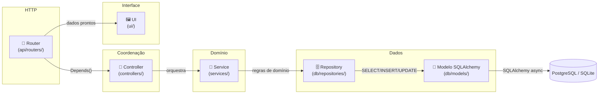
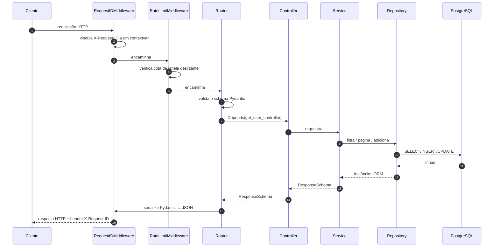

# Arquitetura

O SDK impõe um fatiamento estrito **router → controller → service → repository**. Todo projeto Tempest segue o mesmo formato, então um desenvolvedor jogado em um repositório novo encontra o arquivo que precisa logo de primeira.

## As quatro camadas



## O que vive onde

!!! abstract "Responsabilidades de cada camada"

    | Camada | Responsável por | NUNCA toca |
    | --- | --- | --- |
    | **Router** | Verbos HTTP, status codes, schemas de request/response, `Depends()` | DB, lógica de negócio |
    | **Controller** | Coordenação entre múltiplos services, política transversal (log de auditoria, emissão de outbox, notificação downstream) | DB, formato de request/response |
    | **Service** | Regras de domínio (unicidade, estado derivado, fluxo transacional) | HTTP, tipos do SQLAlchemy |
    | **Repository** | Queries SQLAlchemy async cruas, CRUD + filtro + paginação | Regras de domínio, HTTP |
    | **UI** (quando o serviço entrega HTML) | Páginas, componentes, formulários e folha de estilo — *como isso aparece* | DB, controllers, services, HTTP |

O repository **DEVE** ser uma subclasse (ou instância) de [`BaseRepository[ModelType]`][tempest_fastapi_sdk.BaseRepository]. O service **DEVE** ser uma subclasse de [`BaseService[RepositoryT, ResponseT]`][tempest_fastapi_sdk.BaseService]. O controller **DEVE** ser uma subclasse de [`BaseController[ServiceT, ResponseT]`][tempest_fastapi_sdk.BaseController] — mesmo quando todo método é um pass-through, porque o controller é a costura para adicionar coordenação entre services mais tarde — ou, quando orquestra vários services sem CRUD de um recurso só, de [`Controller`][tempest_fastapi_sdk.Controller] (veja [Controller que orquestra](#controller-que-orquestra-controller)).

## Layout obrigatório do projeto

```text
<service>/
├── main.py                          # ONE-LINER: from src.server import run; run()
└── src/ (ou app/)
    ├── __init__.py                  # re-exporta run de src.server
    ├── server.py                    # uvicorn.run() programático + app FastAPI no nível do módulo
    ├── api/
    │   ├── app.py                   # factory create_app() — middleware + handlers + wiring (magro)
    │   ├── routers/                 # endpoints HTTP, sem lógica de negócio
    │   ├── dependencies/            # PACOTE (auth.py + resources.py + controllers.py / services.py)
    │   └── docs/                    # customização do OpenAPI
    ├── controllers/<contexto>/      # orquestra entre services — uma classe por módulo
    ├── services/<contexto>/         # camada de lógica de negócio
    ├── schemas/                     # DTOs de request/response Pydantic v2
    ├── scripts/                     # composition.py (build_*) + o trabalho que as tasks rodam
    ├── core/                        # settings.py + enums.py + types.py + exceptions.py
    ├── db/ (opcional)
    │   ├── configs/names.py         # nomes das tabelas, fonte única
    │   ├── models/<contexto>/       # modelos ORM SQLAlchemy
    │   └── repositories/<contexto>/ # camada de acesso a dados
    ├── ui/ (opcional)               # camada de interface — só com o extra [ssr]
    │   ├── pages/                   # uma classe por tela
    │   ├── layout/                  # o chrome que toda página herda
    │   ├── components/              # peças reutilizáveis
    │   └── styles.py                # a folha de estilo tipada do serviço
    ├── utils/ (opcional)            # helpers stateless compartilhados
    ├── queue/ (opcional)            # consumers/publishers FastStream
    └── tasks/ (opcional)            # TaskIQ: queue, names, dispatch, worker + módulos de registro
```

Cada `<contexto>` é um subpacote por domínio (`products/`, `orders/`), com
uma classe por módulo, e todo `__init__.py` reexporta com import relativo. O
porquê de cada uma dessas formas, com o exemplo errado e o certo e o código
do `tempest check` que a cobra, está em
[Arquitetura recomendada](recommended-architecture.md).

!!! tip "`db/configs/names.py` evita uma classe de erro"
    Guardar o nome de cada tabela numa constante faz o `__tablename__` e
    a string da `ForeignKey` saírem do mesmo símbolo — renomear vira uma
    linha, em vez de uma caça a strings espalhadas. Errar uma ponta não
    falha na hora: o SQLAlchemy só resolve o alvo da FK ao montar os
    mapeamentos, então o erro chega na subida da aplicação, ou dentro de
    uma migração apontando para tabela que não existe mais.

    Desde a **v0.291.0** o `tempest new` já escreve o arquivo com o nome
    da tabela de usuário, e o `CLAUDE.md` do projeto ensina a receita a
    partir dele. Ver
    [Banco de dados › Centralizando os nomes das tabelas](recipes/database.md#centralizando-os-nomes-das-tabelas).

!!! warning "Regras inegociáveis"

    - `main.py` na raiz do serviço é um **one-liner** que importa `run` de `src.server`. Nunca `subprocess.run(["uvicorn", ...])`.
    - `src/server.py` expõe tanto uma função `run()` quanto a instância `app` importável.
    - `api/dependencies/` é **sempre um pacote**, nunca um arquivo plano. A auth vive em `auth.py`; os provedores factory vivem em `controllers.py` (ou `services.py` quando ainda não há camada de controller).
    - **Singletons de infra (db / storage / mail) vivem em `dependencies/resources.py`**, construídos uma vez (`db = AsyncDatabaseManager(**settings.database_kwargs())`) e acessados via provedores `get_db` / `get_session` / `get_storage` / `get_mailer`. O `app.py` **importa** esses recursos para o lifespan e o wiring dos routers — não os constrói inline. Isso mantém o `app.py` magro e dá um único dono do ciclo de vida dos recursos.
    - Routers recebem controllers (e sessões/recursos) via `Depends`, nunca construídos inline.
    - Endpoints meta (`/health`, `/tool-spec`) ficam no **prefixo raiz**; endpoints de negócio ficam sob `/api/<domínio>`.

## A camada de interface (`ui/`)

Quando o serviço entrega HTML — e não só JSON —, ele ganha uma quinta
camada, **no mesmo nível** de `controllers` e `services`. Ela existe
só com o extra `[ssr]`; sem ele, não crie o pacote vazio.

| Camada | Pode importar | Nunca importa |
| --- | --- | --- |
| `api/routers` | `controllers`, `ui`, `schemas` | `db` |
| `ui` | `schemas`, outras partes de `ui` | `controllers`, `services`, `db` |
| `controllers` | `services`, `schemas` | `ui` |
| `services` | `db/repositories`, `schemas` | `ui` |

!!! warning "A página recebe dados prontos"
    Uma página **não** busca nada: o router carrega pelo controller e
    passa o resultado já materializado. `await` dentro de `body()`
    significa que uma responsabilidade escorregou de camada.

`tempest new <serviço> --extras "ssr"` escreve a camada inteira
funcionando (e `tempest generate --src` a adiciona a um projeto que já
existe). Detalhes em
[Camada UI](recipes/ui.md),
[Formulários a partir de schemas Pydantic](recipes/ui-forms.md) e
[CSS tipado](recipes/ui-css.md).

!!! tip "E quando o frontend é um app, não uma página"
    A camada `ui` renderiza HTML **no servidor**. Quando a tela precisa de
    estado no cliente — uma SPA — o caminho continua sendo Python: o
    **[tempestweb](recipes/tempestweb-frontend.md)** escreve a interface e
    compila para WASM (ou roda em server-mode), e o SDK serve o build com
    `make_web_app_router` / `build_web_app`, na mesma origem da API. As duas
    opções convivem: [Fullstack web](fullstack-web.md) compara quando usar
    cada uma.

## Ciclo de vida da requisição



Cada passo tem um dono claro — o **router nunca conversa com o SQLAlchemy**, o **repository nunca levanta exceções HTTP** (ele levanta a `not_found_exception` configurada no `__init__`, e o exception handler a transforma no envelope JSON).

## Envelope de exceções

O SDK traz [`AppException`][tempest_fastapi_sdk.AppException] + [`register_exception_handlers`][tempest_fastapi_sdk.register_exception_handlers] para que todo erro no seu serviço serialize no mesmo formato JSON:

```json
{
    "detail": "Usuário não encontrado",
    "code": "USER_NOT_FOUND",
    "details": {"user_id": "01923..."}
}
```

O frontend ramifica no `code` (estável, legível por máquina), nunca no `detail` (que pode estar traduzido).

### O 500 também passa pelo CORS

Uma exceção que nenhum handler trata vira `500` com `code: "INTERNAL_SERVER_ERROR"`. O Starlette executa o handler de `Exception` no `ServerErrorMiddleware`, a camada **mais externa** da pilha, então sozinho esse envelope sairia sem passar pelo `CORSMiddleware`: sem `Access-Control-Allow-Origin`, o navegador descarta a resposta e o `fetch` rejeita com `TypeError: Failed to fetch`, sem status, sem `code` e sem `X-Request-ID`.

Por isso o `register_exception_handlers` instala também o [`ErrorEnvelopeMiddleware`][tempest_fastapi_sdk.ErrorEnvelopeMiddleware] como o middleware **mais interno**. Dali o 500 passa por todo middleware que você adicionou, e a ordem das chamadas deixa de importar:

```python
from fastapi import FastAPI
from fastapi.testclient import TestClient

from tempest_fastapi_sdk import (
    RequestIDMiddleware,
    apply_cors,
    register_exception_handlers,
)

app: FastAPI = FastAPI()
app.add_middleware(RequestIDMiddleware)
apply_cors(app, origins=["https://front.example"])
register_exception_handlers(app)


@app.get("/boom")
async def boom() -> None:
    raise RuntimeError("falha não tratada")


client: TestClient = TestClient(app, raise_server_exceptions=False)
response = client.get("/boom", headers={"Origin": "https://front.example"})
print(response.status_code, response.headers["access-control-allow-origin"])
print(response.json()["details"]["request_id"] == response.headers["x-request-id"])
```

```text
500 https://front.example
True
```

!!! note "O que continua igual"
    - A camada **não decide CORS**. Uma origem fora da lista continua sem o header, também no 500.
    - Depois de enviar o envelope, a exceção é **re-levantada**, como o Starlette já fazia: o servidor ASGI continua logando, e um `TestClient` com o default `raise_server_exceptions=True` continua levantando no seu teste.
    - Uma falha depois que a resposta começou (stream quebrado no meio) é re-levantada sem segunda resposta, porque o status já foi para a rede. Ela é logada e chega ao `on_server_error` uma vez, como o 500 comum.
    - `register_exception_handlers` precisa rodar **antes** de a aplicação subir; depois disso a pilha está montada e ele levanta `RuntimeError`.

## Para onde ir agora

| Você quer… | Leia |
| --- | --- |
| Construir uma feature passo a passo | **[Tutorial »](tutorial.md)** |
| Conectar um helper específico | **[Receitas »](recipes/index.md)** |
| Consultar a assinatura de uma classe | **[Referência »](reference.md)** |
| Atualizar de uma versão antiga | **[Guia de migração »](migration.md)** |

## Camadas de controllers & services


`BaseService[RepositoryT, ResponseT]` e `BaseController[ServiceT, ResponseT]` são esqueletos genéricos que casam com o fatiamento do SDK (router → controller → service → repository). Eles expõem métodos CRUD pass-through para que endpoints simples possam herdar deles sem sobrescrever nada; você sobrescreve apenas os métodos que precisam de orquestração.

O que você herda ao subclassear `BaseService[RepositoryT, ResponseT]`:

| Método | Retorna | Notas |
| --- | --- | --- |
| `get_by_id(id)` | `ResponseT` | Aguarda `repository.get_by_id` + `repository.map_to_response`. Levanta `repository.not_found_exception` quando não encontra. |
| `get_or_none(filters)` | ``ResponseT | None`` | Mesmo formato, retorna `None` em vez de levantar. |
| `list(filters=None, order_by=None, ascending=True)` | `list[ResponseT]` | Retorna `[]` quando não há correspondência (nunca levanta). |
| `paginate(filters=None, order_by=None, page=1, page_size=20, ascending=True)` | `dict` com `items` mapeados + `total`/`page`/`page_size`/`pages`. | Paginação por offset via `repository.paginate`. |
| `count(filters=None)` | `int` | Pass-through para `repository.count`. |
| `exists(filters)` | `bool` | Pass-through para `repository.exists`. |
| `update(id, data)` | `ResponseT` | Busca por id, copia os campos presentes em `data` (tipado por `UpdateT`, o 3º parâmetro genérico opcional — default `BaseSchema`) na instância, persiste e mapeia. `to_dict()` descarta unset/`None`, então serve PUT e PATCH. |
| `delete(id)` | `None` | Hard delete via `repository.delete`. |

`map_to_response` é aguardado com `await` quando retorna uma coroutine, então mappers async funcionam de forma transparente — sem precisar sobrescrever o método.

O que você herda ao subclassear `BaseController[ServiceT, ResponseT]`:

| Método | Encaminha para | Notas |
| --- | --- | --- |
| `get_by_id(id)` | `service.get_by_id` | Mesmo tipo de retorno do service. |
| `list(filters, order_by, ascending)` | `service.list` | Igual. |
| `paginate(filters, order_by, page, page_size, ascending)` | `service.paginate` | Igual. |
| `count(filters)` | `service.count` | Igual. |
| `update(id, data)` | `service.update` | Igual. |
| `delete(id)` | `service.delete` | Igual. |

!!! tip "Tipando o payload de `update` ponta a ponta"
    O 3º parâmetro genérico é o schema de update, e ele precisa ser o **mesmo** nas duas camadas: um service declarado como `BaseService[Repo, Resp, MeuUpdateSchema]` encaixa em `BaseController[MeuService, Resp, MeuUpdateSchema]`. Omitir o 3º parâmetro em qualquer uma delas cai no default `BaseSchema`, e o `data` de `update` chega sem tipo preciso.

    ```python
    from tempest_fastapi_sdk import BaseController, BaseService

    from src.db.repositories import CoinPackRepository
    from src.schemas import CoinPackResponseSchema, CoinPackUpdateSchema


    class CoinPackService(
        BaseService[CoinPackRepository, CoinPackResponseSchema, CoinPackUpdateSchema]
    ):
        """Service tipado sobre o schema de update concreto."""


    class CoinPackController(
        BaseController[CoinPackService, CoinPackResponseSchema, CoinPackUpdateSchema]
    ):
        """Controller que repete o mesmo schema de update."""
    ```

    !!! warning "Requer 0.167.1+"
        Em versões anteriores esse par falhava no type check com `Type parameter "UpdateT@BaseService" is invariant, but "CoinPackUpdateSchema" is not the same as "BaseSchema"` — o bound de `ServiceT` deixava o parâmetro invariante fixado em `BaseSchema`. Corrigido em 0.167.1; nada muda em runtime.

Quando um caso de uso precisa de regras de domínio, sobrescreva o método herdado no service. Quando um caso de uso precisa coordenar mais de um service, sobrescreva o método herdado (ou adicione um novo) no controller. O router nunca cresce — ele só depende do controller.

```python
# src/services/user_service.py
from uuid import UUID

from tempest_fastapi_sdk import BaseService

from src.db.repositories import UserRepository
from src.schemas.user import UserCreate, UserResponse, UserUpdate
from src.utils.security import password_utils


class UserService(BaseService[UserRepository, UserResponse]):
    """Business logic for the user feature."""

    async def signup(self, data: UserCreate) -> UserResponse:
        # Business logic — hash the password, then delegate to the repo.
        instance = self.repository.map_to_model(
            {
                "name": data.name,
                "email": data.email,
                "password_hash": password_utils.hash(data.password),
            },
        )
        created = await self.repository.add(instance)
        return self.repository.map_to_response(created)


# src/controllers/user_controller.py
from tempest_fastapi_sdk import BaseController

from src.schemas.user import UserCreate, UserResponse
from src.services.user_service import UserService


class UserController(BaseController[UserService, UserResponse]):
    """Thin orchestration over UserService."""

    async def signup(self, data: UserCreate) -> UserResponse:
        # Pass-through today; the controller is the seam to add
        # cross-service coordination later (audit log, outbox event,
        # downstream notification, etc.) without touching the router.
        return await self.service.signup(data)


# src/api/dependencies/controllers.py
from fastapi import Depends
from sqlalchemy.ext.asyncio import AsyncSession

from src.api.dependencies.resources import db
from src.controllers.user_controller import UserController
from src.db.repositories import UserRepository
from src.services.user_service import UserService


def get_user_controller(
    session: AsyncSession = Depends(db.session_dependency),
) -> UserController:
    # UserRepository é uma subclasse de BaseRepository[UserModel] cujo
    # __init__ injeta `model=UserModel` via super().__init__(session, model=UserModel).
    # Veja o tutorial para o esqueleto completo:
    # https://mauriciobenjamin700.github.io/tempest-fastapi-sdk/tutorial/#6-repository
    return UserController(UserService(UserRepository(session)))


# src/api/routers/users.py
from fastapi import APIRouter, Depends, status

from src.api.dependencies.controllers import get_user_controller
from src.controllers.user_controller import UserController
from src.schemas.user import UserCreate, UserResponse

router = APIRouter(prefix="/users", tags=["users"])


@router.post(
    "/",
    response_model=UserResponse,
    status_code=status.HTTP_201_CREATED,
)
async def create_user(
    data: UserCreate,
    controller: UserController = Depends(get_user_controller),
) -> UserResponse:
    return await controller.signup(data)
```

Mantenha os controllers presentes mesmo quando só fazem pass-through — o grafo de imports fica uniforme entre os serviços, então adicionar política transversal mais tarde não muda a assinatura do router.

### Controller que orquestra — `Controller`

`BaseController` recebe **um** service e repassa o CRUD dele. Um controller
que coordena vários services — emitir a fatura, lançar no razão, notificar —
não tem `get_by_id` nem `delete` de um recurso só; herdar `BaseController` ali
entregaria ao router métodos que não significam nada. Para esse caso existe
[`Controller`][tempest_fastapi_sdk.Controller], a raiz da camada: sem método
nenhum, só a convenção — services **injetados** pelo `__init__`, nenhum acesso
a banco (sem sessão, sem repository). `BaseController` é a especialização CRUD
dela, então `isinstance(controller, Controller)` vale para os dois.

| O seu controller… | Herde |
| --- | --- |
| repassa o CRUD de um recurso, via um service | `BaseController[ServiceT, ResponseT, UpdateT]` |
| coordena vários services, sem CRUD de recurso único | `Controller` |

```python
# src/controllers/billing_controller.py
from uuid import UUID

from tempest_fastapi_sdk import Controller

from src.schemas import ChargeResponse
from src.services import InvoiceService, LedgerService, NotificationService


class BillingController(Controller):
    """Charge = invoice + ledger posting + notification."""

    def __init__(
        self,
        invoices: InvoiceService,
        ledger: LedgerService,
        notifications: NotificationService,
    ) -> None:
        self.invoices: InvoiceService = invoices
        self.ledger: LedgerService = ledger
        self.notifications: NotificationService = notifications

    async def charge(self, customer_id: UUID, amount_cents: int) -> ChargeResponse:
        invoice = await self.invoices.issue(customer_id, amount_cents)
        await self.ledger.post(invoice.id, amount_cents)
        await self.notifications.invoice_issued(customer_id, invoice.id)
        return ChargeResponse(invoice_id=invoice.id, amount_cents=amount_cents)


# src/api/dependencies/controllers.py
from fastapi import Depends
from sqlalchemy.ext.asyncio import AsyncSession

from src.api.dependencies.resources import db
from src.controllers.billing_controller import BillingController
from src.db.repositories import InvoiceRepository, LedgerRepository
from src.services import InvoiceService, LedgerService, NotificationService


def get_billing_controller(
    session: AsyncSession = Depends(db.session_dependency),
) -> BillingController:
    return BillingController(
        InvoiceService(InvoiceRepository(session)),
        LedgerService(LedgerRepository(session)),
        NotificationService(),
    )
```

O provider monta os services, o controller só os recebe — a sessão fica no
provider e nos repositories, nunca no controller.

!!! note "A convenção não é checada em runtime"
    O `__init__` é da subclasse, e distinguir service de repository pela
    anotação exigiria resolver as forward references dela. Quem garante a
    regra é a revisão.

## Padrões de service, repository e controller

As seções acima dizem **o que** cada camada herda. Esta responde as
perguntas que aparecem no primeiro serviço de verdade: onde mora o mapper,
o que fazer quando o service precisa de **dois** repositories, como a
`session`, as settings e o mailer chegam até o controller, onde a checagem
de permissão roda, e o que o router devolve.

Tudo num exemplo só, completo — copie para um arquivo e rode com
`uv run python app.py`. Num projeto, cada classe mora na sua camada
(`db/models/`, `schemas/`, `core/exceptions.py`, `db/repositories/`,
`services/`, `controllers/`, `api/dependencies/controllers.py`,
`api/routers/`); aqui estão juntas para o exemplo rodar sozinho.

```python
from collections.abc import AsyncIterator
from contextlib import asynccontextmanager
from uuid import UUID

from fastapi import APIRouter, Depends, FastAPI, status
from fastapi.testclient import TestClient
from pydantic import Field
from sqlalchemy import ForeignKey, String
from sqlalchemy.ext.asyncio import AsyncSession
from sqlalchemy.orm import Mapped, mapped_column

from tempest_fastapi_sdk import (
    AsyncDatabaseManager,
    BaseAppSettings,
    BaseController,
    BaseModel,
    BaseRepository,
    BaseResponseSchema,
    BaseSchema,
    BaseService,
    NotFoundException,
    ValidationException,
    register_exception_handlers,
)


class Settings(BaseAppSettings):
    """Service configuration."""

    MAX_PRICE_CENTS: int = 100_000


class CategoryModel(BaseModel):
    """A catalogue category."""

    name: Mapped[str] = mapped_column(String(64))


class ProductModel(BaseModel):
    """A product, always inside a category."""

    name: Mapped[str] = mapped_column(String(64))
    price_cents: Mapped[int]
    category_id: Mapped[UUID] = mapped_column(ForeignKey("category.id"))


class ProductCreateSchema(BaseSchema):
    """Product creation payload."""

    name: str = Field(min_length=1, max_length=64)
    price_cents: int = Field(gt=0)
    category_id: UUID


class ProductResponseSchema(BaseResponseSchema):
    """A product as the API returns it."""

    name: str
    price_cents: int
    category_id: UUID


class CategoryNotFoundError(NotFoundException):
    """The given category does not exist."""

    code: str = "CATEGORY_NOT_FOUND"


class ProductNotFoundError(NotFoundException):
    """The given product does not exist."""

    code: str = "PRODUCT_NOT_FOUND"


class ProductPriceAboveLimitError(ValidationException):
    """The price is above the configured ceiling."""

    code: str = "PRODUCT_PRICE_ABOVE_LIMIT"


class CategoryRepository(BaseRepository[CategoryModel]):
    """Data access for categories."""

    def __init__(self, session: AsyncSession) -> None:
        """Bind the repository to the session.

        Args:
            session (AsyncSession): The request-scoped session.
        """
        super().__init__(
            session,
            model=CategoryModel,
            not_found_exception=CategoryNotFoundError,
        )


class ProductRepository(BaseRepository[ProductModel]):
    """Data access for products; owns the response mapper."""

    def __init__(self, session: AsyncSession) -> None:
        """Bind the repository to the session.

        Args:
            session (AsyncSession): The request-scoped session.
        """
        super().__init__(
            session,
            model=ProductModel,
            not_found_exception=ProductNotFoundError,
        )

    def map_to_response(self, instance: ProductModel) -> ProductResponseSchema:
        """Map a row to the response schema.

        Args:
            instance (ProductModel): The ORM row.

        Returns:
            ProductResponseSchema: The product, ready for the API.
        """
        return ProductResponseSchema.model_validate(instance)


class ProductService(BaseService[ProductRepository, ProductResponseSchema]):
    """Business rules for products."""

    def __init__(
        self,
        repository: ProductRepository,
        *,
        categories: CategoryRepository,
        max_price_cents: int,
    ) -> None:
        """Take the main repository plus what the creation rule reads.

        Args:
            repository (ProductRepository): The resource's own repository.
            categories (CategoryRepository): Read to validate the category.
            max_price_cents (int): Price ceiling, taken from the settings.
        """
        super().__init__(repository)
        self.categories: CategoryRepository = categories
        self.max_price_cents: int = max_price_cents

    async def create(self, data: ProductCreateSchema) -> ProductResponseSchema:
        """Create a product in an existing category, under the price ceiling.

        Args:
            data (ProductCreateSchema): The creation payload.

        Returns:
            ProductResponseSchema: The created product.

        Raises:
            CategoryNotFoundError: When the category does not exist.
            ProductPriceAboveLimitError: When the price is above the ceiling.
        """
        await self.categories.get_by_id(data.category_id)
        if data.price_cents > self.max_price_cents:
            raise ProductPriceAboveLimitError(
                details={"max_price_cents": self.max_price_cents},
            )
        instance = self.repository.map_to_model(data.to_dict())
        instance = await self.repository.add(instance)
        return self.repository.map_to_response(instance)


class ProductController(BaseController[ProductService, ProductResponseSchema]):
    """Product use cases; a pass-through for now."""

    async def create(self, data: ProductCreateSchema) -> ProductResponseSchema:
        """Create a product.

        Args:
            data (ProductCreateSchema): The creation payload.

        Returns:
            ProductResponseSchema: The created product.
        """
        return await self.service.create(data)


settings: Settings = Settings()
db: AsyncDatabaseManager = AsyncDatabaseManager("sqlite+aiosqlite:///:memory:")


def get_settings() -> Settings:
    """Return the process settings.

    Returns:
        Settings: The single instance, replaceable through ``dependency_overrides``.
    """
    return settings


def get_product_controller(
    session: AsyncSession = Depends(db.session_dependency),
    app_settings: Settings = Depends(get_settings),
) -> ProductController:
    """Build repository, service and controller for one request.

    Args:
        session (AsyncSession): The request-scoped session.
        app_settings (Settings): The process settings.

    Returns:
        ProductController: The controller bound to that session.
    """
    service = ProductService(
        ProductRepository(session),
        categories=CategoryRepository(session),
        max_price_cents=app_settings.MAX_PRICE_CENTS,
    )
    return ProductController(service)


router: APIRouter = APIRouter(prefix="/api/products", tags=["products"])


@router.post("", status_code=status.HTTP_201_CREATED)
async def create_product(
    data: ProductCreateSchema,
    controller: ProductController = Depends(get_product_controller),
) -> ProductResponseSchema:
    """Create a product.

    Args:
        data (ProductCreateSchema): The creation payload.
        controller (ProductController): Injected by the provider.

    Returns:
        ProductResponseSchema: The created product.
    """
    return await controller.create(data)


@router.get("/{product_id}")
async def get_product(
    product_id: UUID,
    controller: ProductController = Depends(get_product_controller),
) -> ProductResponseSchema:
    """Fetch a product by id.

    Args:
        product_id (UUID): The product id.
        controller (ProductController): Injected by the provider.

    Returns:
        ProductResponseSchema: The product.
    """
    return await controller.get_by_id(product_id)


@asynccontextmanager
async def lifespan(app: FastAPI) -> AsyncIterator[None]:
    """Create the tables and one sample category.

    Args:
        app (FastAPI): The application.

    Yields:
        None: While the application runs.
    """
    await db.create_tables()
    async with db.get_session_context() as session:
        session.add(CategoryModel(id=UUID(int=1), name="Books"))
        await session.commit()
    yield
    await db.disconnect()


app: FastAPI = FastAPI(lifespan=lifespan)
register_exception_handlers(app)
app.include_router(router)


with TestClient(app) as client:
    created = client.post(
        "/api/products",
        json={"name": "Dune", "price_cents": 5990, "category_id": str(UUID(int=1))},
    )
    print(created.status_code, created.json()["name"])
    fetched = client.get(f"/api/products/{created.json()['id']}")
    print(fetched.status_code, fetched.json()["price_cents"])
    missing = client.post(
        "/api/products",
        json={"name": "Dune", "price_cents": 5990, "category_id": str(UUID(int=2))},
    )
    print(missing.status_code, missing.json()["code"])
    too_high = client.post(
        "/api/products",
        json={"name": "Rare", "price_cents": 500_000, "category_id": str(UUID(int=1))},
    )
    print(too_high.status_code, too_high.json()["code"], too_high.json()["details"])
    app.dependency_overrides[get_settings] = lambda: Settings(MAX_PRICE_CENTS=1_000)
    capped = client.post(
        "/api/products",
        json={"name": "Dune", "price_cents": 5990, "category_id": str(UUID(int=1))},
    )
    print(capped.status_code, capped.json()["details"])
```

```text
201 Dune
200 5990
404 CATEGORY_NOT_FOUND
422 PRODUCT_PRICE_ABOVE_LIMIT {'max_price_cents': 100000}
422 {'max_price_cents': 1000}
```

Vamos por partes.

### O mapper mora no repository

`ProductRepository.map_to_response` é a **única** tradução de linha ORM para
schema de resposta do recurso. O `BaseService` chama esse método em todo
caminho que devolve dado mapeado — `get_by_id`, `get_or_none`, `list`,
`paginate` e `update` —, então o `get_product` do exemplo funciona sem uma
linha de service: o `get_by_id` herdado busca a linha e passa pelo mapper.

O contrato, como o código está hoje:

| Método do `BaseRepository` | Padrão da base | Quem chama |
| --- | --- | --- |
| `map_to_response(instance)` | levanta `NotImplementedError("Subclasses must implement map_to_response")` | `BaseService.get_by_id` / `get_or_none` / `list` / `paginate` / `update` |
| `map_to_model(data)` | `self.model(**data)` | o seu service, ao criar (`self.repository.map_to_model(data.to_dict())`) |
| `map_to_schema(instance)` | levanta `NotImplementedError` | ninguém no SDK; existe para o seu código |

Não é método abstrato no sentido de `abc`: o repository sem mapper instancia
normalmente, e `count`, `exists` e `delete` funcionam. A falha aparece na
primeira chamada que mapeia — no HTTP, um `500`. Por isso todo repository
entregue a um `BaseService` implementa `map_to_response`; o
`CategoryRepository` do exemplo não implementa porque nenhum `BaseService`
o recebe — o `ProductService` só chama `get_by_id` nele, que devolve a linha
sem mapear.

!!! tip "Mapper `async`"
    Quando o mapeamento precisa de `await` (carregar uma relação, por
    exemplo), declare `async def map_to_response`. O `BaseService` aguarda o
    resultado quando ele é awaitable — nada para sobrescrever no service.

Por que no repository, e não num helper do service: o mapper fica ao lado da
query que carregou a linha, e o `BaseService` só consegue entregar o CRUD
herdado porque sabe onde procurá-lo. Um service que reescreve
`list` como `[self.repository.map_to_response(x) for x in ...]` está
reimplementando a base.

### Um repository por service — e quando são vários

`BaseService[RepositoryT, ResponseT, UpdateT]` recebe **um** repository no
`__init__`: o do recurso cujo CRUD ele herda. O terceiro parâmetro genérico é
opcional (veja [o tip acima](#camadas-de-controllers-services)). Quando um
caso de uso precisa de mais dados, a pergunta é *de quem é a regra*:

| Situação | Onde o segundo repository entra |
| --- | --- |
| A regra é deste recurso e só **lê** ou **grava junto** outro dado — validar que a categoria existe, gravar pedido e itens | parâmetro keyword-only no `__init__` do service, depois do `super().__init__(repository)` — como `categories` no exemplo |
| O outro dado tem regras próprias e já tem service | o **controller** recebe os dois services e orquestra (veja [`Controller`](#controller-que-orquestra-controller)) |
| O service não tem repository nenhum (catálogo estático, fachada de API externa) | sem `BaseService`; marque a classe com `# tempest: no-base-service` |

O `__init__` do `ProductService` acrescenta dependências, então não é o
`__init__` redundante que o `SVC003` acusa — ele só acusa o que guarda o
repository e nada mais.

!!! warning "Duas escritas, uma transação"
    Cada método de escrita do `BaseRepository` faz `COMMIT` sozinho. Quando a
    regra grava em dois repositories, abra `async with
    self.repository.transaction():` em volta das duas escritas. O bloco vale
    para todo repository da **mesma** `AsyncSession` — e é a fábrica que
    garante isso, montando os dois sobre a sessão da requisição. Detalhes em
    [Transações](recipes/transactions.md).

### Controllers chegam por fábricas em `Depends`

`get_product_controller` é o único lugar que sabe montar o grafo: abre a
sessão da requisição, lê as settings, constrói os dois repositories, o
service e o controller. O router só declara
`controller: ProductController = Depends(get_product_controller)`.

Num projeto, as fábricas moram em `src/api/dependencies/controllers.py`, e
os recursos de processo (`db`, storage, mailer) em
`src/api/dependencies/resources.py`. Cada dependência da fábrica é outra
`Depends`, nunca um import lido direto no meio do corpo — é o que faz a
última requisição do exemplo funcionar: um `dependency_overrides[get_settings]`
trocou o teto de preço sem tocar em router, controller ou service. O mesmo
vale para o mailer:

```python
from fastapi import Depends
from sqlalchemy.ext.asyncio import AsyncSession

from tempest_fastapi_sdk import EmailUtils

from src.api.dependencies.resources import get_mailer, get_session
from src.controllers import InviteController
from src.core.settings import Settings, get_settings
from src.db.repositories import InviteRepository
from src.services import InviteService


def get_invite_controller(
    session: AsyncSession = Depends(get_session),
    mailer: EmailUtils = Depends(get_mailer),
    settings: Settings = Depends(get_settings),
) -> InviteController:
    """Build the invite controller for one request.

    Args:
        session (AsyncSession): The request-scoped session.
        mailer (EmailUtils): The process-wide mailer.
        settings (Settings): The process settings.

    Returns:
        InviteController: The controller wired to those resources.
    """
    service = InviteService(
        InviteRepository(session),
        mailer=mailer,
        code_secret=settings.INVITE_CODE_SECRET,
    )
    return InviteController(service)
```

O que a fábrica evita é o router montando o controller —
`InviteController(session, mailer=mailer, code_secret=settings.X)` dentro do
handler. Ali o router passa a conhecer sessão, settings e a assinatura de
três classes, e cada endpoint que usa o controller repete a montagem.

!!! note "O que o `tempest new` gera"
    O scaffold já sai neste formato. `src/api/dependencies/controllers.py`
    traz `get_service_info_controller`, a fábrica do `GET /api/`
    placeholder, que recebe `Settings` por `Depends(get_settings)` e monta o
    controller com o `build_service_info_controller` de
    `src/scripts/composition.py`, o composition root que task, script e
    teste também chamam; o router (`src/api/routers/service_info.py`)
    declara `controller: ServiceInfoController = Depends(get_service_info_controller)`.
    `src/core/settings.py` expõe `get_settings()` com `@lru_cache` — o
    `settings` de módulo continua lá, é a mesma instância, para o que roda
    fora de requisição (recursos, logging, lifespan, `server.py`, Alembic).
    `src/api/dependencies/resources.py` traz `db`, `get_db` e `get_session`
    sempre, `get_mailer` só com `[email]` e `get_storage` só com `[minio]`
    — e, com eles, o `EmailSettings` / `StorageSettings` no `Settings`. O
    `tests/test_smoke.py` gerado troca o `TITLE` por
    `dependency_overrides[get_settings]` e confere que o `GET /api/`
    responde o valor novo.

### Guards: dependência no router ou `@requires` no método

O SDK oferece dois lugares para checar permissão, e eles respondem
perguntas diferentes:

| Ferramenta | Pergunta | Onde roda |
| --- | --- | --- |
| `make_token_dependency`, `make_jwt_user_dependency`, `make_role_dependency`, `make_permission_dependency` | "quem chama?" / "o token carrega este papel ou esta permissão?" | dependência de rota, antes do handler |
| `@requires(guard, ...)` com `require_authenticated`, `require_active`, `require_admin`, `make_flag_guard`, `make_value_guard` ou um guard seu | "este usuário, já carregado, passa por esta invariante?" | qualquer função que recebe o usuário — handler, controller ou service |

O caminho que mantém o router sem regra: **autenticação na dependência,
invariante no método do caso de uso**. A dependência resolve o usuário e o
router o repassa; o `@requires` fica no método do controller, de modo que
quem chamar o caso de uso — rota HTTP, consumer de fila, comando de CLI —
passa pela mesma checagem.

```python
import asyncio
from uuid import UUID

from sqlalchemy import String
from sqlalchemy.ext.asyncio import AsyncSession
from sqlalchemy.orm import Mapped, mapped_column

from tempest_fastapi_sdk import (
    AppException,
    AsyncDatabaseManager,
    BaseController,
    BaseModel,
    BaseRepository,
    BaseResponseSchema,
    BaseService,
    BaseUserModel,
    requires,
)
from tempest_fastapi_sdk.auth import require_admin


class AccountModel(BaseUserModel):
    """An account that calls the API."""


class ProductModel(BaseModel):
    """A catalogue product."""

    name: Mapped[str] = mapped_column(String(64))


class ProductResponseSchema(BaseResponseSchema):
    """A product as the API returns it."""

    name: str


class ProductRepository(BaseRepository[ProductModel]):
    """Data access for products."""

    def __init__(self, session: AsyncSession) -> None:
        """Bind the repository to the session.

        Args:
            session (AsyncSession): The active session.
        """
        super().__init__(session, model=ProductModel)

    def map_to_response(self, instance: ProductModel) -> ProductResponseSchema:
        """Map a row to the response schema.

        Args:
            instance (ProductModel): The ORM row.

        Returns:
            ProductResponseSchema: The product, ready for the API.
        """
        return ProductResponseSchema.model_validate(instance)


class ProductService(BaseService[ProductRepository, ProductResponseSchema]):
    """Business rules for products."""


class ProductController(BaseController[ProductService, ProductResponseSchema]):
    """Product use cases."""

    @requires(require_admin)
    async def remove(self, product_id: UUID, user: AccountModel) -> None:
        """Delete a product; administrators only.

        Args:
            product_id (UUID): The product to delete.
            user (AccountModel): The caller, already authenticated.
        """
        await self.service.delete(product_id)


async def main() -> None:
    """Call the use case as a regular account, then as an administrator."""
    db: AsyncDatabaseManager = AsyncDatabaseManager("sqlite+aiosqlite:///:memory:")
    await db.create_tables()
    admin = AccountModel(email="ana@example.com", hashed_password="x", is_admin=True)
    member = AccountModel(email="bia@example.com", hashed_password="x", is_admin=False)
    async with db.get_session_context() as session:
        repository = ProductRepository(session)
        product = await repository.add(ProductModel(name="Dune"))
        controller = ProductController(ProductService(repository))
        try:
            await controller.remove(product.id, member)
        except AppException as exc:
            print(exc.status_code, exc.code)
        await controller.remove(product.id, admin)
        print("left:", await controller.count())
    await db.disconnect()


asyncio.run(main())
```

```text
403 FORBIDDEN
left: 0
```

O guard achou o usuário pela anotação (`AccountModel` herda
`BaseUserModel`), negou a conta comum levantando `ForbiddenException` — que o
`register_exception_handlers` transforma no envelope `403` — e deixou o
administrador passar. Contrato completo do guard, `meta=` e o linter
`tempest permissions` em [Guards de permissão](recipes/permission-guards.md).

### O router devolve schema

Todo handler do exemplo anota o retorno com o schema de resposta
(`-> ProductResponseSchema`) e devolve o que o controller entregou. Com o
mapper no repository, o schema já sai pronto do service — o router não
importa nada de `db/` e não vê linha ORM. O FastAPI usa a anotação de
retorno como `response_model`, então o OpenAPI documenta o schema sem
`response_model=` repetido no decorator.

### O que o `tempest lint-layers` confere

Parte destas regras tem gate; parte não. O `tempest lint-layers` (e o passo
`lint-layers` do `tempest check`) lê o código com `ast` e acusa, como
**erro**:

| Código | O que acusa |
| --- | --- |
| `SVC001` | classe pública em `services/` que não herda `BaseService` |
| `SVC002` | segunda classe pública ou função de módulo num arquivo de `services/` |
| `SVC003` | `__init__` de service que só guarda o repository |
| `REPO001` | método de repository que só repassa para um método do `BaseRepository` |
| `ENUM001` | `BaseStrEnum` cujo nome não termina em `Enum` |
| `RTR001` | classe `*Controller` / `*Service` chamada dentro de `routers/` em vez de chegar por `Depends` |
| `RTR002` | rota cuja anotação de retorno ou `response_model=` cita um model ORM |

As regras de forma de arquivo — pacote de contexto, import pela camada, o
que service e controller recebem, um router por arquivo, a suíte — entram
como **aviso** (`LAY*`, `IMP*`, `DI*`, `REPO002`, `RTR003`/`RTR004`, `STR*`,
`TST*`) e estão em [Arquitetura recomendada](recommended-architecture.md).

Rodado sobre um `src/` com um `FamilyService` cujo `__init__` só chama
`super().__init__(repository)`, um `ProductService` como o do exemplo e um
`class UserRole(BaseStrEnum)`, o resultado é este (caminhos encurtados):

```text
src/core/enums.py:4: ENUM001 `UserRole` inherits BaseStrEnum; rename it to `UserRoleEnum`. The database type name does not change (enum_type_name drops one trailing `Enum`), so no migration is needed.
src/services/family.py:5: SVC003 `FamilyService.__init__` only stores the repository, which BaseService already does; delete it.
```

O `ProductService`, que acrescenta `categories` e `max_price_cents`, passa
limpo. Sobre o `ENUM001`: a partir da v0.313.0 o `enum_type_name` tira um
`Enum` do fim do nome da classe antes de acrescentar `_enum`, então
`UserRole` e `UserRoleEnum` dão o mesmo tipo `user_role_enum` — renomear a
classe para o sufixo não pede `TempestEnum(UserRoleEnum, name="user_role_enum")`
em cada coluna. Banco criado antes, com o nome dobrado, está em
[Colunas enum › Renomear o tipo](recipes/enum-columns.md#renomear-o-tipo).

Troque o `Depends(get_product_controller)` do router por
`ProductController(ProductService(ProductRepository(session)))` e a mesma
execução acusa `RTR001` naquela linha, uma vez por classe montada; anote a
rota com `-> ProductModel` e ela acusa `RTR002`.

Fica **sem gate**, de propósito, uma regra: onde o guard fica. O
`@requires` vale tanto no handler da rota quanto no método do controller —
a receita de [guards de permissão](recipes/permission-guards.md) usa a rota
como primeira forma —, então uma checagem que acusasse a rota acusaria
código correto. Escolher o método do controller, como acima, é revisão.
Tabela completa, o opt-out `# tempest: router-builds` e o que as regras de
router não veem em
[CLI › Regras de camada](recipes/cli.md#regras-de-camada-tempest-lint-layers).

### Recap

- **Mapper no repository.** `map_to_response` é obrigatório para todo
  repository entregue a um `BaseService`; pode ser `async`.
- **Um repository por `BaseService`.** Dado extra que a regra deste recurso
  lê ou grava junto entra como keyword-only no `__init__`; recurso com regra
  própria tem service próprio, e o controller orquestra.
- **Escritas em dois repositories** vão dentro de
  `self.repository.transaction()`, sobre a mesma sessão.
- **Controller vem de fábrica** em `api/dependencies/controllers.py`, que
  recebe sessão, settings e mailer por `Depends`.
- **Autenticação na dependência da rota; invariante com `@requires`** no
  método do caso de uso.
- **Router devolve schema**, anotado no retorno.
- `tempest lint-layers` confere `SVC001`–`SVC003`, `REPO001`, `ENUM001`,
  `RTR001` e `RTR002` como erro, e as regras de forma de arquivo da
  [Arquitetura recomendada](recommended-architecture.md) como aviso; onde o
  guard fica é revisão.
