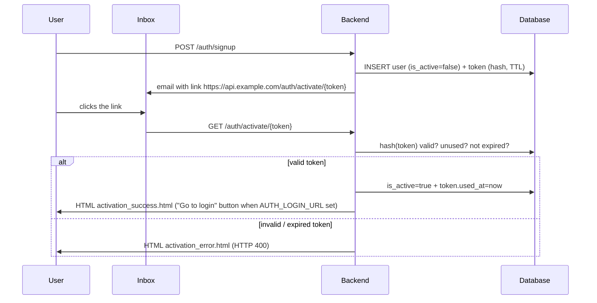

# Five operating modes and local SMTP

Use to pick the mode (production, dev with local SMTP, dev without SMTP, CI, backend-only) and run Mailhog or smtp4dev.

Part of the [Bundled auth flow (signup / activate / login / reset)](../auth-flow.md) recipe.

## Five operating modes

| Mode | When to use | Flags | Where the link appears |
|------|-------------|-------|------------------------|
| **A. Production (SPA)** | Public SaaS, real email, frontend SPA owns the pages | `AUTH_AUTO_ACTIVATE=false`<br>`AUTH_RETURN_TOKEN_IN_RESPONSE=false`<br>`AUTH_BACKEND_LINKS=false`<br>Real SMTP (Mailgun, SES, Postmark…) | The user's inbox → frontend processes the token |
| **B. Local dev with fake SMTP** | Daily development without sending real email | `AUTH_AUTO_ACTIVATE=false`<br>`AUTH_RETURN_TOKEN_IN_RESPONSE=false`<br>SMTP pointing at Mailhog (`localhost:1025`) or smtp4dev (`localhost:2525`) | Mailhog/smtp4dev web UI at `localhost:8025` / `localhost:5000` |
| **C. Dev without SMTP** | Quick validation without spinning up any email container | `AUTH_AUTO_ACTIVATE=false`<br>`AUTH_RETURN_TOKEN_IN_RESPONSE=true`<br>`email=None` or invalid SMTP | HTTP signup response body |
| **D. CI / tests** | Test suite that doesn't exercise activation | `AUTH_AUTO_ACTIVATE=true` | Nowhere — signup returns the JWT pair directly |
| **E. Backend-only** *(v0.32.0+)* | You want 100% control on the backend — zero responsibility on the frontend. Ideal for APIs without a SPA, MVPs, internal tools. | `AUTH_BACKEND_LINKS=true`<br>URL templates point at the **backend** (`https://api.example.com/auth/activate/{token}`)<br>`AUTH_LOGIN_URL=https://app.example.com/login` (optional — shows a "Go to login" button on the HTML pages) | The backend renders HTML success/error directly — the user only clicks the link in the email |

### Mode A — production

```bash
AUTH_AUTO_ACTIVATE=false
AUTH_RETURN_TOKEN_IN_RESPONSE=false
SMTP_HOST=smtp.mailgun.org
SMTP_PORT=587
SMTP_USERNAME=postmaster@mg.example.com
SMTP_PASSWORD=...                          # secret, don't commit
SMTP_FROM_ADDR=noreply@yourdomain.com
AUTH_ACTIVATION_URL_TEMPLATE=https://app.yourdomain.com/activate?token={token}
AUTH_PASSWORD_RESET_URL_TEMPLATE=https://app.yourdomain.com/reset?token={token}
AUTH_EMAIL_CHANGE_URL_TEMPLATE=https://app.yourdomain.com/confirm-email?token={token}
AUTH_EMAIL_VERIFICATION_URL_TEMPLATE=https://app.yourdomain.com/verify-email?token={token}
```

!!! warning "In production every mailed link must be `https` and public"
    With `ENV=production` (and e-mail switched on), `AuthSettings` refuses
    the boot when any of the four templates that go into an e-mail —
    `AUTH_ACTIVATION_URL_TEMPLATE`, `AUTH_PASSWORD_RESET_URL_TEMPLATE`,
    `AUTH_EMAIL_CHANGE_URL_TEMPLATE`, `AUTH_EMAIL_VERIFICATION_URL_TEMPLATE`
    — points at a host nobody outside can reach (`localhost`, `127.0.0.1`,
    `::1`, `0.0.0.0`, or a reserved domain such as `example.com` and
    `*.test`) or uses plain `http://` (the token travels in the URL). The
    defaults (`http://localhost:3000/...`) fail both rules, so set **all
    four**, even for flows you don't use yet. With `EMAIL_ENABLED=false`
    the rule does not apply: the link never leaves.

Flow: signup → real email lands in the inbox → user clicks → frontend calls `POST /auth/activate/{token}` → login.

### Mode B — dev with local SMTP (Mailhog or smtp4dev)

Same `.env` as mode A, but point SMTP at a local container that **intercepts** the emails instead of actually mailing them. **Use this mode in day-to-day dev** — the flow is identical to production, so you catch template bugs, encoding issues, charset problems, etc. while avoiding real-email spam.

```bash
# .env.dev
AUTH_AUTO_ACTIVATE=false
AUTH_RETURN_TOKEN_IN_RESPONSE=false
SMTP_HOST=localhost
SMTP_PORT=1025                             # Mailhog SMTP default
SMTP_USERNAME=                             # empty — Mailhog doesn't authenticate
SMTP_PASSWORD=
SMTP_FROM_ADDR=dev@local
AUTH_ACTIVATION_URL_TEMPLATE=http://localhost:5173/activate?token={token}
AUTH_PASSWORD_RESET_URL_TEMPLATE=http://localhost:5173/reset?token={token}
```

Open `http://localhost:8025` (Mailhog) or `http://localhost:5000` (smtp4dev) to inspect the intercepted emails. See **[Mailhog vs smtp4dev](#mailhog-vs-smtp4dev)** below.

### Mode C — dev without SMTP (link in body)

No SMTP container at all. Signup returns the activation link in the JSON body:

```bash
AUTH_AUTO_ACTIVATE=false
AUTH_RETURN_TOKEN_IN_RESPONSE=true
AUTH_ACTIVATION_URL_TEMPLATE=http://localhost:5173/activate?token={token}
```

Request:

```bash
curl -X POST localhost:8000/auth/signup \
  -H 'content-type: application/json' \
  -d '{"email":"dev@local","password":"abcdefghijkl","name":"Dev"}'
```

Response (the actual `SignupResponseSchema` shape):

```json
{
  "user_id": "0193e9ea-7c4b-7c8e-bc05-2a3a8d9f7e10",
  "activation_required": true,
  "activation_url": "http://localhost:5173/activate?token=aBcD...xYz",
  "access_token": null,
  "refresh_token": null
}
```

Paste the URL into the browser / curl to exercise `POST /auth/activate/{token}`.

### Mode D — CI / tests (skip everything)

```bash
AUTH_AUTO_ACTIVATE=true
```

Signup skips activation entirely and returns `{access_token, refresh_token}` straight away. Use **only in tests** or when the product is internal and every user is already trusted.

### Mode E — backend-only (v0.32.0+)

When you'd rather have the **whole** link experience happen on the backend, with no frontend page in the loop, flip `AUTH_BACKEND_LINKS=True`. The router then mounts **five extra HTML endpoints** — `GET /auth/activate/{token}`, `GET /auth/password-reset/{token}`, `POST /auth/password-reset/{token}` (form-encoded), `GET /auth/email-change/{token}` and `GET /auth/email-verify/{token}`. The email points the user straight at those endpoints; the backend activates the account / processes the reset / renders HTML success or error — using bundled Jinja2 templates you can shadow.

It is also the mode for **dev without a frontend**: the whole cycle — signup, link, login and protected route — with measured responses is in [Backend only](backend-only.md).

```bash
# .env — Mode E (backend-only)
AUTH_BACKEND_LINKS=true
AUTH_AUTO_ACTIVATE=false
AUTH_RETURN_TOKEN_IN_RESPONSE=false

# IMPORTANT: URL templates point at the BACKEND, not the frontend.
AUTH_ACTIVATION_URL_TEMPLATE=https://api.yourdomain.com/auth/activate/{token}
AUTH_PASSWORD_RESET_URL_TEMPLATE=https://api.yourdomain.com/auth/password-reset/{token}
AUTH_EMAIL_CHANGE_URL_TEMPLATE=https://api.yourdomain.com/auth/email-change/{token}
AUTH_EMAIL_VERIFICATION_URL_TEMPLATE=https://api.yourdomain.com/auth/email-verify/{token}

# Optional: your login URL. When set, the backend-rendered success/error
# pages display a "Go to login" button. When null, the button is hidden
# (pure server-side, zero coupling with any frontend).
AUTH_LOGIN_URL=https://app.example.com/login

SMTP_HOST=smtp.mailgun.org
SMTP_PORT=587
SMTP_FROM_ADDR=noreply@yourdomain.com
```

!!! danger "Link returns 404? Align the template with the router's mount prefix"
    The endpoints above are **relative to wherever you mount `make_auth_router`**.
    If you include the router under a prefix — common to separate business routes:

    ```python
    app.include_router(make_auth_router(...), prefix="/api")
    ```

    then the real activation route becomes `GET /api/auth/activate/{token}`, **not**
    `/auth/activate/{token}`. But `AUTH_ACTIVATION_URL_TEMPLATE` is a literal string
    — it has **no** idea about the prefix. If the template points at
    `.../auth/activate/{token}` (without `/api`), the email link hits a
    non-existent route and returns **404**, even though signup returned `201`.

    ```bash
    # ❌ router mounted with prefix="/api", but the template lacks /api → 404
    AUTH_ACTIVATION_URL_TEMPLATE=https://api.example.com/auth/activate/{token}

    # ✅ template aligned with the actual mount prefix
    AUTH_ACTIVATION_URL_TEMPLATE=https://api.example.com/api/auth/activate/{token}
    ```

    Two checks when configuring Mode E: **(1)** the host is the backend's
    **public domain** (never `localhost` — the link runs in the user's browser,
    not on the server); **(2)** the path includes **every prefix** you mounted the
    router under.

Flow:



Password reset follows the same pattern: GET renders an HTML form; POST (form-encoded) consumes the token and renders success/error.

**Bundled HTML templates (shadow by dropping the same filename under `template_dir`):**

| Template | Endpoint that renders it | Jinja2 variables exposed |
|----------|--------------------------|--------------------------|
| `activation_success.html` | `GET /auth/activate/{token}` (success) | `user`, `login_url` |
| `activation_error.html` | `GET /auth/activate/{token}` (failure) | `reason`, `login_url` |
| `password_reset_form.html` | `GET /auth/password-reset/{token}` | `user`, `form_action`, `min_length`, `error`, `login_url` |
| `password_reset_success.html` | `POST /auth/password-reset/{token}` (success) | `user`, `login_url` |
| `password_reset_error.html` | `POST /auth/password-reset/{token}` (bad token) | `reason`, `login_url` |

**To override:** pass `template_dir` to `make_auth_router` and add files with the same filenames.

```python
from fastapi import FastAPI

from tempest_fastapi_sdk import UserAuthService, make_auth_router

from src.api.dependencies.resources import db
from src.core.settings import settings
from src.db.models import UserModel, UserTokenModel

auth_service = UserAuthService(
    user_model=UserModel,
    token_model=UserTokenModel,
    auth_settings=settings,
    jwt_settings=settings,
)
app = FastAPI()


app.include_router(
    make_auth_router(
        auth_service,
        session_factory=db.session_dependency,
        template_dir="src/templates/auth",   # optional
    ),
)
```

!!! tip "Override per language (since v0.59.0)"
    The bundled templates now live in **per-language subfolders**
    (`pt-BR/` and `en-US/`). You have two ways to override, and the SDK
    searches in this order (the first that exists wins):

    1. `template_dir/<locale>/activation_success.html` — override **just
       that language** (e.g. `src/templates/auth/pt-BR/...`).
    2. `template_dir/activation_success.html` — **flat** override, applies
       to every language (backward compatible with pre-0.59.0; keeps
       working with no changes).

    In short: if you already had flat templates, **you don't need to
    change anything**. If you want a different look per language, create
    the subfolder.

**Mode E trade-offs:**

- ✅ **Zero frontend dependency** — the backend is the single source of truth for the auth flow.
- ✅ **MVP in minutes** — no need to create SPA routes to process tokens.
- ✅ **Works in frontend-less projects** — public APIs, intranets, internal tooling.
- ⚠️ **JWT is not auto-delivered** — after activation, the user signs in manually (clicking "Go to login" and entering credentials). By design: zero token leak via URL, history, or server logs.
- ⚠️ **Requires the `[email]` extra** (Jinja2) to render the HTML pages — same dependency as the email template renderer. Without it, `make_auth_router` raises `RuntimeError` at construction naming the extra, instead of the first click activating the account and answering 500.
- ⚠️ **No CSRF on the reset form** — the HTML form posts traditionally without a CSRF token. The reset token is one-shot + short TTL + bound to a single user, but consider plugging in `CSRFMiddleware` if attackers can predict active URLs.

The **JSON** endpoints (`POST /auth/activate/{token}`, `POST /auth/password-reset/confirm`) are still mounted — you can mix Mode E with SPA endpoints.

## Mailhog vs smtp4dev

Both intercept local SMTP and render emails in a web UI. Relevant differences:

| Aspect | Mailhog | smtp4dev |
|--------|---------|----------|
| Docker image | `mailhog/mailhog:latest` | `rnwood/smtp4dev:latest` |
| Default SMTP port | `1025` | `2525` (configurable) |
| UI port | `8025` | `5000` |
| Image size | ~10 MB | ~120 MB (.NET) |
| Multi-account / multi-inbox | no — single mailbox | yes — filters by recipient |
| HTTP / REST API | yes (`/api/v2/messages`) | yes (built-in Swagger) |
| DKIM / SPF validation | no | yes |
| Upstream maintenance | archived in 2020, still works | active |

**Suggestion:** start with Mailhog (lighter, zero-config) and switch to smtp4dev when you need multi-inbox or DKIM inspection. For the signup → activate → reset cycle, **Mailhog is enough**.

### `docker-compose.yaml` — Mailhog

```yaml
services:
  mailhog:
    image: mailhog/mailhog:latest
    container_name: mailhog
    ports:
      - "1025:1025"  # SMTP — point SMTP_HOST here
      - "8025:8025"  # web UI
```

`SMTP_PORT=1025`, open `http://localhost:8025`.

### `docker-compose.yaml` — smtp4dev

```yaml
services:
  smtp4dev:
    image: rnwood/smtp4dev:latest
    container_name: smtp4dev
    ports:
      - "2525:25"     # SMTP — point SMTP_HOST here
      - "5000:80"     # web UI
    environment:
      - ServerOptions__HostName=smtp4dev
```

`SMTP_PORT=2525`, open `http://localhost:5000`.

!!! tip "`tempest generate --docker` already includes Mailhog"
    When the project pins the `[email]` extra, `tempest generate --docker` **auto-appends** a Mailhog service to the `docker-compose.yaml` — no manual paste and no `--with mailhog` flag. The blocks above are just a reference, or for when you prefer smtp4dev.
