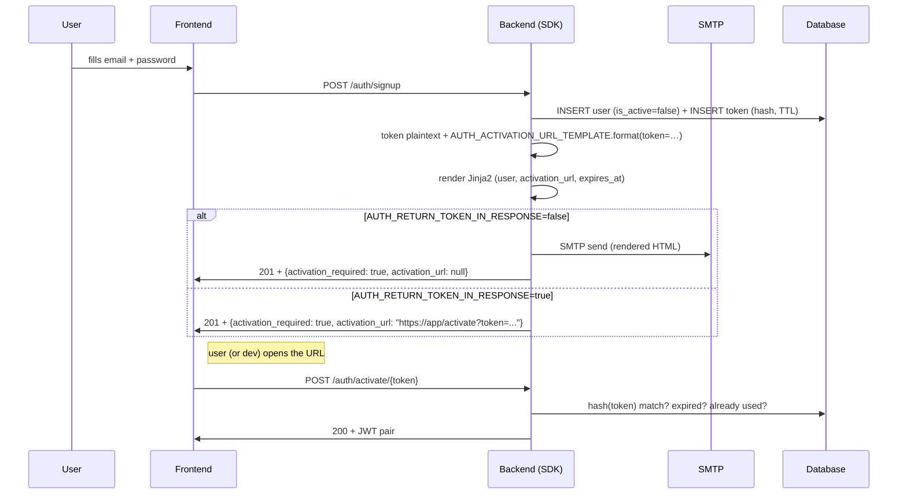

# Emails: anatomy, brand and templates

Use to understand how link, template and URL fit together, put your brand on the emails and override the Jinja2 templates.

Part of the [Bundled auth flow (signup / activate / login / reset)](https://mauriciobenjamin700.github.io/tempest-fastapi-sdk/en/recipes/auth-flow.md) recipe.

## Email anatomy

Three different concepts that look the same. Here's what each one does, exactly once, in pseudo-code:

```text
1. SDK generates a random opaque token (64-char string).
2. AUTH_ACTIVATION_URL_TEMPLATE.format(token=…)  →  link with the token embedded.
3. Renders AUTH_ACTIVATION_TEMPLATE (Jinja2 HTML) passing { user, activation_url, expires_at, expires_at_str }.
4. EmailUtils.send(to=user.email, subject=..., html=<rendered HTML>).
```

In prose:

- **Opaque token** — random string the SDK generates, hashes (SHA-256), and stores in the `user_tokens` table. The plaintext leaves over email **only once**; the database keeps just the hash.
- **URL template** (`AUTH_ACTIVATION_URL_TEMPLATE`) — literal format string used to build the URL the user will click. In modes A–C **it points at the frontend**: it reads `?token=…` from the query string and calls `POST /auth/activate/{token}` on the backend. In [Mode E](https://mauriciobenjamin700.github.io/tempest-fastapi-sdk/en/recipes/auth-flow/modes.md#mode-e-backend-only-v0320) it points at the backend, which activates the account on `GET`. Full table in [Where the template points](https://mauriciobenjamin700.github.io/tempest-fastapi-sdk/en/recipes/auth-flow/settings.md#where-auth_activation_url_template-points).
- **Jinja2 template** (`AUTH_ACTIVATION_TEMPLATE`) — filename of the HTML template inside `EmailUtils.template_dir`. It's **the HTML body of the email**, not the URL. It receives the `{ user, activation_url, expires_at, expires_at_str }` context and renders the final markup. Use `{{ expires_at_str }}` in the template — it's the expiry already formatted short (e.g. `2026-06-21 23:25 (UTC)`, no seconds); `expires_at` is still available as the raw `datetime` if you want to format it yourself.

!!! warning "URL template ≠ Jinja2 template"
    `AUTH_ACTIVATION_URL_TEMPLATE` is a Python `.format()`-style string with just the `{token}` placeholder. **Don't confuse it** with the `.html` file Jinja2 renders. The formatted URL **is injected as a variable** into the Jinja2 context under the name `activation_url`, and the HTML template wraps it in a button.

Visual flow:



---

## The brand in the emails

*(v0.332.0+)*

The flow's five emails (activation, password reset, email change,
verification and the email-changed notice) extend one layout,
`_email_layout.html`: a brand header, a card, a button, a fallback link, an
expiry note and a footer. It is built on tables with inline styles — what
Gmail and Outlook honor — and carries `color-scheme` for clients with a
dark mode.

Four `AuthSettings` env vars dress the email in your brand, with no template
copied:

```bash
# .env
AUTH_EMAIL_BRAND_NAME=Acme
AUTH_EMAIL_BRAND_COLOR=#7c3aed
AUTH_EMAIL_BRAND_LOGO_URL=https://acme.com/logo.png
AUTH_EMAIL_FOOTER_TEXT=Acme Inc · San Francisco, CA
```

- **With no name or logo**, the header is left out; the default is the blue
  button (`#2563eb`) with no brand.
- **A light color adjusts.** The button text and the link color are picked
  from the color's luminance: with `#facc15` (yellow) the button gets dark
  text and the link turns dark gray, because yellow on the white card does
  not read.
- **An invalid value fails the boot.** The color only takes `#rgb`/`#rrggbb`
  and the logo only an absolute `http(s)` URL — both go into an HTML
  attribute, and an email cannot load a relative path.

!!! tip "Your own template still wins"
    A `template_dir` with the same file name (`activation.html`, …) beats
    the SDK's, as before. The context gained `brand` (`name`, `color`,
    `text_color`, `link_color`, `logo_url`, `footer`); your template may use
    it or ignore it. To keep the new layout and change only the text, extend
    `_email_layout.html` and fill the `heading`, `content`, `note` and
    `footer` blocks, with `action_url`, `action_label` and `fallback_label`
    in ``.

Validated in a real browser in both languages, at 800 and 375 px, in light
and dark mode, with a dark brand (`#7c3aed`), a light one (`#facc15`) and no
brand.

## Customizing templates

The SDK ships two bundled Jinja2 templates (`activation.html` + `password_reset.html`) — responsive HTML, inline styles, mobile-friendly. You never need to touch them for an MVP to work. When you want your own branding, drop a file with the **same name** into the `template_dir` you passed to `EmailUtils`:

```text
emails/                            # ← template_dir="emails"
├── activation.html                # overrides the SDK default
└── password_reset.html            # overrides the SDK default
```

`EmailUtils` uses a `ChoiceLoader` internally so Jinja2 looks **first** in your directory and **only falls back** to the bundled template if it can't find yours. Override one, the other, or both — no need to copy the entire template.

### Variables available in the Jinja2 context

| Variable | Type | In which templates | Example |
|----------|------|--------------------|---------|
| `user` | `UserModel` instance | both | `{{ user.email }}`, `{{ user.name }}` (when your model exposes the column) |
| `activation_url` | `str` | `activation.html` | `https://app.example.com/activate?token=aBcD...xYz` |
| `reset_url` | `str` | `password_reset.html` | `https://app.example.com/reset?token=aBcD...xYz` |
| `expires_at` | `datetime` (UTC, timezone-aware) | both | the raw value, if you want to format it yourself |
| `expires_at_str` | `str` | both | **recommended** — already formatted short, no seconds: `2026-06-21 23:25 (UTC)` |

!!! tip "Prefer `expires_at_str`"
    Use `{{ expires_at_str }}` instead of `{{ expires_at }}` — the
    bundled templates do. It's localized (per `AUTH_DEFAULT_LOCALE`) and
    drops the noisy seconds/microseconds. The raw `expires_at` is still
    there if you need a custom format.

### Example: lean `emails/activation.html`

```html
<!doctype html>
<html lang="en">
  <body style="font-family: sans-serif; max-width: 480px; margin: auto;">
    <h1>Welcome, {{ user.name }}!</h1>
    <p>To activate your account, click the button below:</p>
    <p>
      <a href="{{ activation_url }}"
         style="display: inline-block; padding: 12px 24px;
                background: #4f46e5; color: white;
                text-decoration: none; border-radius: 6px;">
        Activate account
      </a>
    </p>
    <p style="color: #6b7280; font-size: 12px;">
      Link valid until {{ expires_at_str }}.
      If you didn't create this account, ignore this email.
    </p>
  </body>
</html>
```

!!! note "Jinja2 only runs when there's a real email"
    In modes C (`AUTH_RETURN_TOKEN_IN_RESPONSE=true`) and D (`AUTH_AUTO_ACTIVATE=true`) the Jinja2 template is **not rendered** — the link goes out raw in the JSON, no HTML. Only modes A and B (real or intercepted SMTP) exercise the template.
