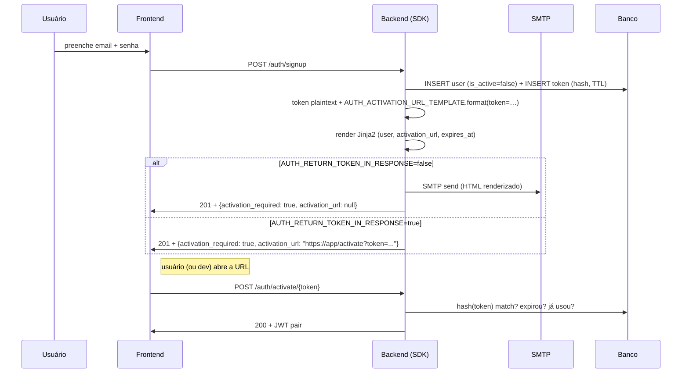

# E-mails: anatomia, marca e templates

Use para entender como link, template e URL se encaixam, pôr a sua marca nos e-mails e sobrescrever os templates Jinja2.

Parte da receita [Bundled auth flow (signup / activate / login / reset)](https://mauriciobenjamin700.github.io/tempest-fastapi-sdk/recipes/auth-flow.md).

## Anatomia de um e-mail

Três conceitos diferentes que parecem o mesmo. Eis o que cada um faz, exatamente uma vez, em pseudo-código:

```text
1. SDK gera um token opaco aleatório (string de 64 chars).
2. AUTH_ACTIVATION_URL_TEMPLATE.format(token=…)  →  link com o token embutido.
3. Renderiza AUTH_ACTIVATION_TEMPLATE (Jinja2 HTML) passando { user, activation_url, expires_at, expires_at_str }.
4. EmailUtils.send(to=user.email, subject=..., html=<HTML renderizado>).
```

Em prosa:

- **Token opaco** — string aleatória que o SDK gera, hasheia (SHA-256) e grava na tabela `user_tokens`. O plaintext sai pelo e-mail **uma única vez**; o banco só guarda o hash.
- **URL template** (`AUTH_ACTIVATION_URL_TEMPLATE`) — formato literal pra montar a URL que vai pro usuário clicar. Nos modos A–C **aponta pro frontend**: ele recebe `?token=…`, capta da query string e chama `POST /auth/activate/{token}` no backend. No [Modo E](https://mauriciobenjamin700.github.io/tempest-fastapi-sdk/recipes/auth-flow/modes.md#modo-e-backend-only-v0320) aponta pro backend, que ativa a conta no `GET`. Tabela completa em [Para onde o template aponta](https://mauriciobenjamin700.github.io/tempest-fastapi-sdk/recipes/auth-flow/settings.md#para-onde-o-auth_activation_url_template-aponta).
- **Jinja2 template** (`AUTH_ACTIVATION_TEMPLATE`) — nome do arquivo HTML dentro do `template_dir` do `EmailUtils`. É **o HTML do e-mail**, não a URL. Recebe o contexto `{ user, activation_url, expires_at, expires_at_str }` e renderiza o markup final. Use `{{ expires_at_str }}` no template — é a data de expiração já formatada e curta (ex.: `21/06/2026 23:25 (UTC)`, sem segundos); `expires_at` continua disponível como `datetime` cru se você quiser formatar do seu jeito.

!!! warning "URL template ≠ Jinja2 template"
    `AUTH_ACTIVATION_URL_TEMPLATE` é uma string Python `.format()`-style — só tem o placeholder `{token}`. **Não confunda** com o arquivo `.html` que o Jinja2 renderiza. A URL formatada **é injetada como variável** no contexto do Jinja2 sob o nome `activation_url`, e o template HTML embrulha ela num botão.

Fluxo visual:



---

## A marca nos e-mails

*(v0.332.0+)*

Os cinco e-mails do fluxo (ativação, reset de senha, troca de e-mail,
verificação e o aviso de e-mail alterado) estendem um layout comum, o
`_email_layout.html`: cabeçalho com a marca, card, botão, link de reserva,
nota de validade e rodapé. O layout é feito em tabela e com estilo inline,
que é o que Gmail e Outlook respeitam, e traz `color-scheme` para os
clientes com modo escuro.

Quatro env vars do `AuthSettings` vestem o e-mail com a sua marca, sem
copiar template:

```bash
# .env
AUTH_EMAIL_BRAND_NAME=Acme
AUTH_EMAIL_BRAND_COLOR=#7c3aed
AUTH_EMAIL_BRAND_LOGO_URL=https://acme.com/logo.png
AUTH_EMAIL_FOOTER_TEXT=Acme Ltda · São Paulo, SP
```

- **Sem nome nem logo**, o cabeçalho sai do e-mail; o default é o botão
  azul (`#2563eb`) sem marca.
- **A cor clara se ajusta.** O texto do botão e a cor do link são
  escolhidos pela luminância da cor: com `#facc15` (amarelo), o botão ganha
  texto escuro e o link vira cinza-escuro, porque amarelo sobre o card branco
  não se lê.
- **Valor inválido derruba o boot.** A cor só aceita `#rgb`/`#rrggbb` e o
  logo só URL absoluta `http(s)` — os dois entram em atributo HTML, e um
  e-mail não consegue carregar caminho relativo.

!!! tip "Template próprio continua valendo"
    Um `template_dir` com o mesmo nome de arquivo (`activation.html`, …)
    vence o do SDK, como antes. O contexto ganhou `brand` (`name`, `color`,
    `text_color`, `link_color`, `logo_url`, `footer`); o seu template pode
    usar ou ignorar. Para manter o layout novo e trocar só o texto, estenda
    o `_email_layout.html` e preencha os blocos `heading`, `content`, `note`
    e `footer`, com `action_url`, `action_label` e `fallback_label` em
    ``.

Validado em browser real nas duas línguas, em 800 e 375 px, em modo claro
e escuro, com marca escura (`#7c3aed`), clara (`#facc15`) e sem marca.

## Customizando templates

O SDK ship dois templates Jinja2 bundled (`activation.html` + `password_reset.html`) — HTML responsivo, inline styles, mobile-friendly. Você nunca precisa mexer neles pra um MVP funcionar. Quando quiser branding próprio, basta criar um arquivo com o **mesmo nome** dentro do `template_dir` que você passou no `EmailUtils`:

```text
emails/                            # ← template_dir="emails"
├── activation.html                # override do default do SDK
└── password_reset.html            # override do default do SDK
```

`EmailUtils` usa um `ChoiceLoader` interno do Jinja2 que procura **primeiro** no seu diretório e **só cai** no template bundled se não achar. Você pode sobrescrever um, o outro, ou ambos — sem precisar copiar o template inteiro.

### Variáveis disponíveis no contexto Jinja2

| Variável | Tipo | Em quais templates | Exemplo |
|----------|------|--------------------|---------|
| `user` | instância de `UserModel` | ambos | `{{ user.email }}`, `{{ user.name }}` (quando seu modelo expõe a coluna) |
| `activation_url` | `str` | `activation.html` | `https://app.example.com/activate?token=aBcD...xYz` |
| `reset_url` | `str` | `password_reset.html` | `https://app.example.com/reset?token=aBcD...xYz` |
| `expires_at` | `datetime` (UTC, timezone-aware) | ambos | o valor cru, se quiser formatar do seu jeito |
| `expires_at_str` | `str` | ambos | **recomendado** — já formatado e curto, sem segundos: `21/06/2026 23:25 (UTC)` |

!!! tip "Prefira `expires_at_str`"
    Use `{{ expires_at_str }}` em vez de `{{ expires_at }}` — os
    templates bundled fazem isso. Ele já vem localizado (conforme
    `AUTH_DEFAULT_LOCALE`) e sem os segundos/microssegundos barulhentos.
    O `expires_at` cru continua disponível se você precisar de um formato
    próprio.

### Exemplo: `emails/activation.html` enxuto

```html
<!doctype html>
<html lang="pt-BR">
  <body style="font-family: sans-serif; max-width: 480px; margin: auto;">
    <h1>Bem-vindo(a), {{ user.name }}!</h1>
    <p>Para ativar sua conta, clique no botão abaixo:</p>
    <p>
      <a href="{{ activation_url }}"
         style="display: inline-block; padding: 12px 24px;
                background: #4f46e5; color: white;
                text-decoration: none; border-radius: 6px;">
        Ativar conta
      </a>
    </p>
    <p style="color: #6b7280; font-size: 12px;">
      Link válido até {{ expires_at_str }}.
      Se você não criou esta conta, ignore este e-mail.
    </p>
  </body>
</html>
```

!!! note "O Jinja2 só roda quando há e-mail real"
    Nos modos C (`AUTH_RETURN_TOKEN_IN_RESPONSE=true`) e D (`AUTH_AUTO_ACTIVATE=true`) o template Jinja2 **não é renderizado** — o link sai cru no JSON, sem HTML. Só os modos A e B (e-mail SMTP real ou interceptado) exercitam o template.
