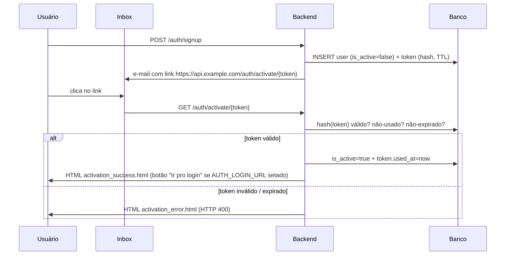

# Cinco modos de operação e SMTP local

Use para escolher o modo (produção, dev com SMTP local, dev sem SMTP, CI, backend-only) e subir Mailhog ou smtp4dev.

Parte da receita [Bundled auth flow (signup / activate / login / reset)](https://mauriciobenjamin700.github.io/tempest-fastapi-sdk/recipes/auth-flow.md).

## Cinco modos de operação

| Modo | Quando usar | Flags | Onde o link aparece |
|------|-------------|-------|--------------------|
| **A. Produção (SPA)** | SaaS público, e-mail real, frontend SPA dono das páginas | `AUTH_AUTO_ACTIVATE=false`<br>`AUTH_RETURN_TOKEN_IN_RESPONSE=false`<br>`AUTH_BACKEND_LINKS=false`<br>SMTP real (Mailgun, SES, Postmark…) | Inbox real → frontend processa o token |
| **B. Dev local com SMTP fake** | Desenvolvimento diário sem mandar e-mail real | `AUTH_AUTO_ACTIVATE=false`<br>`AUTH_RETURN_TOKEN_IN_RESPONSE=false`<br>SMTP apontando pra Mailhog (`localhost:1025`) ou smtp4dev (`localhost:2525`) | UI web do Mailhog/smtp4dev em `localhost:8025` / `localhost:5000` |
| **C. Dev sem SMTP** | Validação rápida sem subir nenhum container de e-mail | `AUTH_AUTO_ACTIVATE=false`<br>`AUTH_RETURN_TOKEN_IN_RESPONSE=true`<br>`email=None` ou SMTP inválido | Body da resposta HTTP do signup |
| **D. CI / testes** | Suite de testes que não exercita activation | `AUTH_AUTO_ACTIVATE=true` | Nenhum — signup já devolve JWT pair |
| **E. Backend-only** *(v0.32.0+)* | Quer 100% de controle no backend — sem responsabilidade no frontend. Ideal pra APIs sem SPA, MVPs, intranets. | `AUTH_BACKEND_LINKS=true`<br>URL templates apontam pro **backend** (`https://api.example.com/auth/activate/{token}`)<br>`AUTH_LOGIN_URL=https://app.example.com/login` (opcional, mostra botão "Ir pro login" nas páginas HTML) | Backend renderiza HTML success/error direto — usuário só clica no link do e-mail |

### Modo A — produção

```bash
AUTH_AUTO_ACTIVATE=false
AUTH_RETURN_TOKEN_IN_RESPONSE=false
SMTP_HOST=smtp.mailgun.org
SMTP_PORT=587
SMTP_USERNAME=postmaster@mg.example.com
SMTP_PASSWORD=...                          # secret, não commitar
SMTP_FROM_ADDR=noreply@seudominio.com.br
AUTH_ACTIVATION_URL_TEMPLATE=https://app.seudominio.com.br/activate?token={token}
AUTH_PASSWORD_RESET_URL_TEMPLATE=https://app.seudominio.com.br/reset?token={token}
AUTH_EMAIL_CHANGE_URL_TEMPLATE=https://app.seudominio.com.br/confirm-email?token={token}
AUTH_EMAIL_VERIFICATION_URL_TEMPLATE=https://app.seudominio.com.br/verify-email?token={token}
```

!!! warning "Em produção, todo link do e-mail precisa ser `https` e público"
    Com `ENV=production` (e o e-mail ligado), o `AuthSettings` recusa o
    boot quando algum dos quatro templates que vão no e-mail —
    `AUTH_ACTIVATION_URL_TEMPLATE`, `AUTH_PASSWORD_RESET_URL_TEMPLATE`,
    `AUTH_EMAIL_CHANGE_URL_TEMPLATE`, `AUTH_EMAIL_VERIFICATION_URL_TEMPLATE`
    — aponta para host que ninguém de fora alcança (`localhost`,
    `127.0.0.1`, `::1`, `0.0.0.0`, ou domínio reservado como `example.com`
    e `*.test`) ou usa `http://` puro (o token viaja na URL). Os defaults
    (`http://localhost:3000/...`) caem nas duas regras, então configure
    **os quatro**, mesmo os de fluxo que você ainda não usa. Com
    `EMAIL_ENABLED=false` a regra não se aplica: o link nunca sai.

Fluxo: signup → e-mail real chega no inbox → usuário clica → frontend chama `POST /auth/activate/{token}` → login.

### Modo B — dev com SMTP local (Mailhog ou smtp4dev)

Mesmo `.env` do modo A, mas apontando o SMTP para um container local que **intercepta** os e-mails em vez de mandar de verdade. **Use este modo no dia-a-dia** — o fluxo é idêntico ao de produção, então você pega bugs de template, encoding, charset, etc. ao mesmo tempo que evita spammar e-mail real.

```bash
# .env.dev
AUTH_AUTO_ACTIVATE=false
AUTH_RETURN_TOKEN_IN_RESPONSE=false
SMTP_HOST=localhost
SMTP_PORT=1025                             # Mailhog SMTP padrão
SMTP_USERNAME=                             # vazio — Mailhog não autentica
SMTP_PASSWORD=
SMTP_FROM_ADDR=dev@local
AUTH_ACTIVATION_URL_TEMPLATE=http://localhost:5173/activate?token={token}
AUTH_PASSWORD_RESET_URL_TEMPLATE=http://localhost:5173/reset?token={token}
```

Abra `http://localhost:8025` (Mailhog) ou `http://localhost:5000` (smtp4dev) pra ver os e-mails interceptados. Veja a seção **[Mailhog vs smtp4dev](#mailhog-vs-smtp4dev)** abaixo.

### Modo C — dev sem SMTP (link no body)

Sem container de SMTP nenhum. O signup devolve o link de ativação no JSON da resposta:

```bash
AUTH_AUTO_ACTIVATE=false
AUTH_RETURN_TOKEN_IN_RESPONSE=true
AUTH_ACTIVATION_URL_TEMPLATE=http://localhost:5173/activate?token={token}
```

Request:

```bash
curl -X POST localhost:8000/auth/signup \
  -H 'content-type: application/json' \
  -d '{"email":"dev@local","password":"abcdefghijkl","name":"Dev"}'
```

Resposta (formato real do `SignupResponseSchema`):

```json
{
  "user_id": "0193e9ea-7c4b-7c8e-bc05-2a3a8d9f7e10",
  "activation_required": true,
  "activation_url": "http://localhost:5173/activate?token=aBcD...xYz",
  "access_token": null,
  "refresh_token": null
}
```

Cole a URL no navegador / curl pra exercitar `POST /auth/activate/{token}`.

### Modo D — CI / testes (skip total)

```bash
AUTH_AUTO_ACTIVATE=true
```

Signup pula ativação inteira e devolve `{access_token, refresh_token}` direto. Use **só em testes** ou quando o produto for interno e cada usuário já é confiável.

### Modo E — backend-only (v0.32.0+)

Quando você prefere que **toda** a experiência do link aconteça no backend, sem nenhuma página no frontend, ative `AUTH_BACKEND_LINKS=True`. O router passa a montar **cinco endpoints HTML** adicionais — `GET /auth/activate/{token}`, `GET /auth/password-reset/{token}`, `POST /auth/password-reset/{token}` (form-encoded), `GET /auth/email-change/{token}` e `GET /auth/email-verify/{token}`. O e-mail aponta o usuário direto pra esses endpoints; o backend ativa a conta / processa o reset / renderiza HTML success ou error — usando templates Jinja2 bundled que você pode shadowar.

É também o modo de **dev sem frontend**: o ciclo inteiro — cadastro, link, login e rota protegida — com as respostas medidas está em [Só o backend](https://mauriciobenjamin700.github.io/tempest-fastapi-sdk/recipes/auth-flow/backend-only.md).

```bash
# .env — Modo E (backend-only)
AUTH_BACKEND_LINKS=true
AUTH_AUTO_ACTIVATE=false
AUTH_RETURN_TOKEN_IN_RESPONSE=false

# IMPORTANTE: URL templates apontam pro BACKEND, não pro frontend.
AUTH_ACTIVATION_URL_TEMPLATE=https://api.seudominio.com.br/auth/activate/{token}
AUTH_PASSWORD_RESET_URL_TEMPLATE=https://api.seudominio.com.br/auth/password-reset/{token}
AUTH_EMAIL_CHANGE_URL_TEMPLATE=https://api.seudominio.com.br/auth/email-change/{token}
AUTH_EMAIL_VERIFICATION_URL_TEMPLATE=https://api.seudominio.com.br/auth/email-verify/{token}

# Opcional: URL do seu login. Quando setado, aparece um botão "Ir pro login"
# nas páginas de success/error renderizadas pelo backend. Quando null,
# o botão é omitido (puro server-side, zero acoplamento com frontend).
AUTH_LOGIN_URL=https://app.example.com/login

SMTP_HOST=smtp.mailgun.org
SMTP_PORT=587
SMTP_FROM_ADDR=noreply@seudominio.com.br
```

!!! danger "Link dá 404? Alinhe o template com o prefixo onde o router está montado"
    Os endpoints acima são **relativos ao ponto onde você monta o `make_auth_router`**.
    Se você inclui o router com um prefixo — comum pra separar rotas de negócio:

    ```python
    app.include_router(make_auth_router(...), prefix="/api")
    ```

    então a rota real de ativação vira `GET /api/auth/activate/{token}`, **não**
    `/auth/activate/{token}`. Mas o `AUTH_ACTIVATION_URL_TEMPLATE` é uma string
    literal — ele **não** sabe do prefixo. Se o template apontar pra
    `.../auth/activate/{token}` (sem `/api`), o link do e-mail bate numa rota
    inexistente e responde **404**, mesmo com o signup retornando `201`.

    ```bash
    # ❌ router montado com prefix="/api", mas o template não tem /api → 404
    AUTH_ACTIVATION_URL_TEMPLATE=https://api.example.com/auth/activate/{token}

    # ✅ template alinhado com o prefixo real de montagem
    AUTH_ACTIVATION_URL_TEMPLATE=https://api.example.com/api/auth/activate/{token}
    ```

    Duas checagens ao configurar o Modo E: **(1)** o host é o **domínio público**
    do backend (nunca `localhost` — o link roda no browser do usuário, não no
    servidor); **(2)** o path inclui **todo prefixo** com que você montou o router.

Fluxo:



Password reset segue padrão similar: GET renderiza form HTML; POST (form-encoded) consome o token e renderiza success/error.

**Templates HTML bundled (override droppando o mesmo nome no `template_dir`):**

| Template | Endpoint que renderiza | Variáveis Jinja2 disponíveis |
|----------|------------------------|------------------------------|
| `activation_success.html` | `GET /auth/activate/{token}` (sucesso) | `user`, `login_url` |
| `activation_error.html` | `GET /auth/activate/{token}` (falha) | `reason`, `login_url` |
| `password_reset_form.html` | `GET /auth/password-reset/{token}` | `user`, `form_action`, `min_length`, `error`, `login_url` |
| `password_reset_success.html` | `POST /auth/password-reset/{token}` (sucesso) | `user`, `login_url` |
| `password_reset_error.html` | `POST /auth/password-reset/{token}` (token inválido) | `reason`, `login_url` |

**Pra override:** passe `template_dir` no `make_auth_router` e crie arquivos de mesmo nome.

```python
from fastapi import FastAPI

from tempest_fastapi_sdk import UserAuthService, make_auth_router

from src.api.dependencies.resources import db
from src.core.settings import settings
from src.db.models import UserModel, UserTokenModel

auth_service = UserAuthService(
    user_model=UserModel,
    token_model=UserTokenModel,
    auth_settings=settings,
    jwt_settings=settings,
)
app = FastAPI()


app.include_router(
    make_auth_router(
        auth_service,
        session_factory=db.session_dependency,
        template_dir="src/templates/auth",   # opcional
    ),
)
```

!!! tip "Override por idioma (desde v0.59.0)"
    Os templates bundled agora moram em **subpastas por idioma**
    (`pt-BR/` e `en-US/`). Você tem duas formas de override, e o SDK
    procura nesta ordem (a primeira que existir vence):

    1. `template_dir/<locale>/activation_success.html` — override **só
       daquele idioma** (ex.: `src/templates/auth/pt-BR/...`).
    2. `template_dir/activation_success.html` — override **flat**, vale
       pra todos os idiomas (compatível com versões anteriores à 0.59.0;
       continua funcionando sem mudar nada).

    Ou seja: se você já tinha templates flat, **não precisa mexer em
    nada**. Se quiser um visual diferente por idioma, crie a subpasta.

**Trade-offs do Modo E:**

- ✅ **Zero dependência do frontend** — backend é fonte única da verdade do fluxo de auth.
- ✅ **MVP em minutos** — sem precisar criar rotas SPA pra processar tokens.
- ✅ **Funciona em projetos sem frontend** — APIs públicas, intranets, ferramentas internas.
- ⚠️ **JWT não é entregue automaticamente** — após ativação, o usuário precisa fazer login manualmente (clicando em "Ir pro login" e usando as credenciais). Por design: zero leak de token em URL, history, ou server logs.
- ⚠️ **Requer `[email]` extra** (Jinja2) pra renderizar as páginas HTML — mesma dependência do template de e-mail. Sem ele, o `make_auth_router` levanta `RuntimeError` na construção citando o extra, em vez de o primeiro clique ativar a conta e responder 500.
- ⚠️ **CSRF na form de reset** — o form HTML usa POST tradicional sem token CSRF. Aceita a request porque o token de reset é one-shot + TTL curto + bound a um user específico, mas considere acoplar `CSRFMiddleware` se atacantes conseguirem prever URLs ativas.

Os endpoints **JSON** (`POST /auth/activate/{token}`, `POST /auth/password-reset/confirm`) continuam montados — você pode usar Modo E + manter SPA endpoints ao mesmo tempo.

## Mailhog vs smtp4dev

Os dois interceptam SMTP local e renderizam os e-mails numa UI web. Diferenças relevantes:

| Aspecto | Mailhog | smtp4dev |
|---------|---------|----------|
| Imagem Docker | `mailhog/mailhog:latest` | `rnwood/smtp4dev:latest` |
| Porta SMTP padrão | `1025` | `2525` (configurável) |
| Porta da UI | `8025` | `5000` |
| Tamanho da imagem | ~10 MB | ~120 MB (.NET) |
| Multi-conta / multi-inbox | não — uma única caixa | sim — filtra por destinatário |
| API HTTP / REST | sim (`/api/v2/messages`) | sim (Swagger built-in) |
| Validação de DKIM / SPF | não | sim |
| Manutenção upstream | arquivado em 2020, ainda funciona | ativa |

**Sugestão:** comece com Mailhog (mais leve, zero-config) e migre pra smtp4dev quando precisar de multi-inbox ou inspeção de DKIM. Para o ciclo signup → activate → reset, **Mailhog é suficiente**.

### `docker-compose.yaml` — Mailhog

```yaml
services:
  mailhog:
    image: mailhog/mailhog:latest
    container_name: mailhog
    ports:
      - "1025:1025"  # SMTP — aponte SMTP_HOST aqui
      - "8025:8025"  # UI web
```

`SMTP_PORT=1025`, abra `http://localhost:8025`.

### `docker-compose.yaml` — smtp4dev

```yaml
services:
  smtp4dev:
    image: rnwood/smtp4dev:latest
    container_name: smtp4dev
    ports:
      - "2525:25"     # SMTP — aponte SMTP_HOST aqui
      - "5000:80"     # UI web
    environment:
      - ServerOptions__HostName=smtp4dev
```

`SMTP_PORT=2525`, abra `http://localhost:5000`.

!!! tip "`tempest generate --docker` já inclui o Mailhog"
    Quando o projeto fixa o extra `[email]`, o `tempest generate --docker` **anexa automaticamente** um serviço Mailhog ao `docker-compose.yaml` — sem colar bloco na mão e sem flag `--with mailhog`. Os blocos acima ficam só como referência, ou para quem prefere smtp4dev.
